# Module 1: Memory architecture

Phase 1 kept talking about "the stack" and "the heap" without saying much about what they are. This module is where I pin that down. The running example for all of Phase 2 is a storage server that receives a request like "write this 100 MB file to an SSD" and has to keep the file metadata, the data buffer, the request and the connection details somewhere while it works. So: where does all of that actually live?

All the code is in [`examples/`](examples/). `./run.sh` builds and runs every example, including the one that crashes on purpose. The output is from GCC 11 on x86-64 Linux, and the addresses change on every run because of address-space randomisation.

| File | What it shows | Run it |
|---|---|---|
| [`regions.cpp`](examples/regions.cpp) | Where code, globals, heap and locals land, and `/proc/self/maps` | [Compiler Explorer](https://godbolt.org/z/f9d3PTEP6) |
| [`stack_frames.cpp`](examples/stack_frames.cpp) | Each nested call gets a frame below its caller | [Compiler Explorer](https://godbolt.org/z/a6ebfnMvj) |
| [`stack_overflow.cpp`](examples/stack_overflow.cpp) | A 100 MB local array crashing an 8 MB stack (broken on purpose) | [Compiler Explorer](https://godbolt.org/z/jM9cqshzc) |

---

## 1. One process, one address space

The RAM in the machine is shared by every running program, but no program sees it directly. The operating system gives each process its own virtual address space, and the program only ever deals in virtual addresses. Inside that space, memory is split into regions with different jobs.

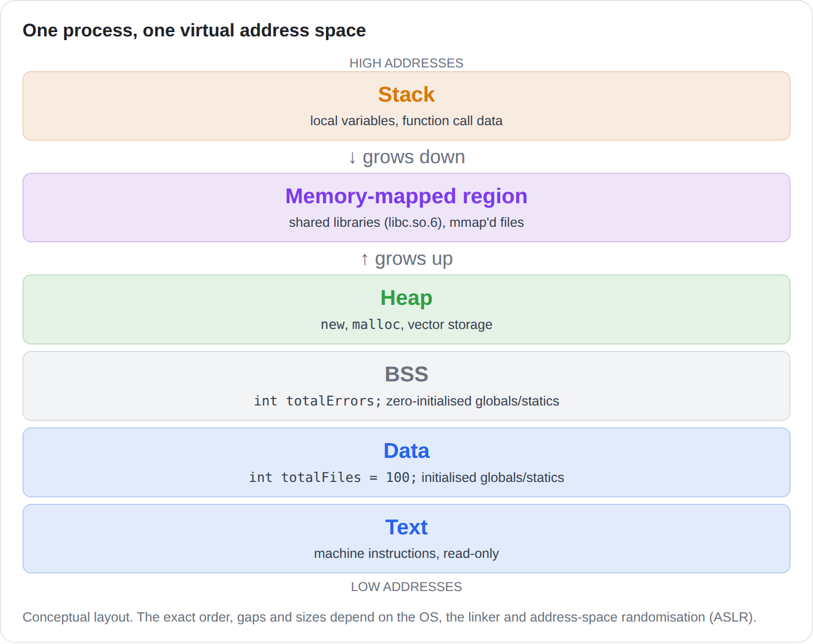

That picture is the textbook version, so I wanted to check it on my machine. `regions.cpp` declares one thing of each kind and prints its address:

```cpp
int totalFiles = 100;   // initialised global: data segment
int totalErrors;        // zero-initialised global: bss segment

void writeFile() {}     // code: text segment

int main() {
    int fileSize = 4096;              // local: stack
    int* buffer = new int[1024];      // dynamic: heap
    ...
}
```

```text
text  &writeFile   = 0x587a2d256589
data  &totalFiles  = 0x587a2d25c010
bss   &totalErrors = 0x587a2d25c154
heap  buffer       = 0x587a31982eb0
stack &fileSize    = 0x7fff57542c34
```

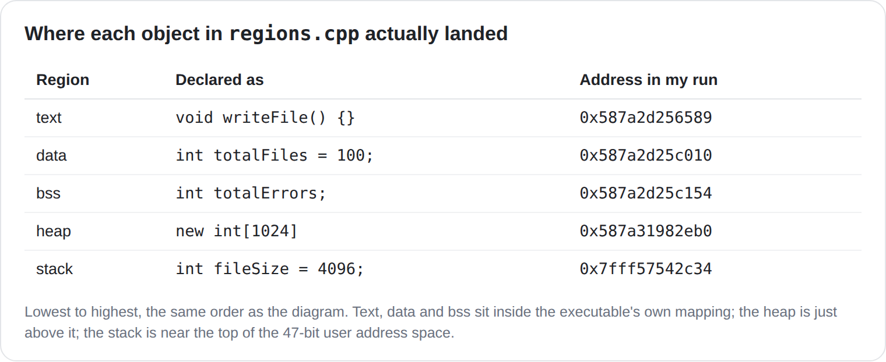

The order matches the diagram. The program also prints its own `/proc/self/maps`, which is the kernel's list of what is mapped where in this process:

```text
587a2d253000-587a2d256000 r--p 000 regions
587a2d256000-587a2d259000 r-xp 000 regions
587a2d259000-587a2d25b000 r--p 000 regions
587a2d25b000-587a2d25c000 r--p 000 regions
587a2d25c000-587a2d25d000 rw-p 000 regions
587a31971000-587a31992000 rw-p 000 [heap]
7e66d8400000-7e66d8428000 r--p 000 libc.so.6
7e66d8428000-7e66d85bd000 r-xp 000 libc.so.6
...
7fff57523000-7fff57544000 rw-p 000 [stack]
```

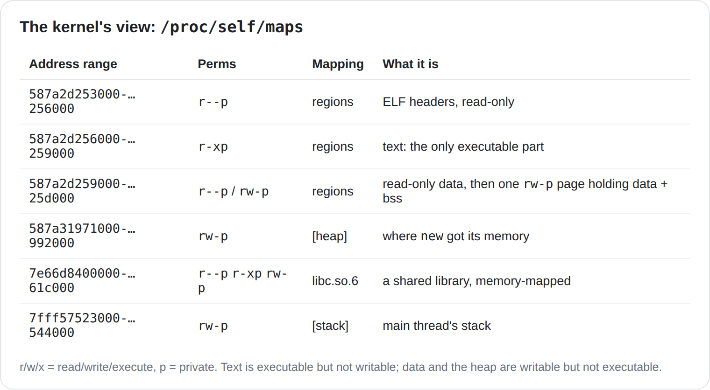

`writeFile` sits in the only `r-xp` (readable, executable) part of the executable. `totalFiles` and `totalErrors` are both in the single `rw-p` page right after it. `[heap]` and `[stack]` are labelled for me, and `libc.so.6` is in the memory-mapped area in between. The permissions matter too: code can be executed but not written, and data can be written but not executed.

This is a conceptual layout, not a promise. The exact order, the gaps and the sizes depend on the OS, the linker and randomisation.

## 2. The stack: memory for function calls

```cpp
void writeFile() {
    int fileSize = 100;
    int bufferSize = 4096;
    std::cout << fileSize;
}
```

`fileSize` and `bufferSize` have automatic storage duration (Module 2 explains the term). In practice they live in the function's stack frame, the block of stack memory used for one call. When `writeFile()` starts, its locals come alive; when it returns, their lifetimes end. That is all tied to the scope they're declared in.

A frame can hold locals, saved registers and the return address, although the compiler is free to keep a variable only in a register and never give it a stack slot at all.

### Nested calls

```cpp
void writeFile() {
    int bufferSize = 4096;
}

void processRequest() {
    int requestId = 10;
    writeFile();
}
```

While `writeFile()` runs, both frames exist, with the newer one on top. `stack_frames.cpp` prints one local from each level:

```text
  main():           &mainLocal  = 0x7ffe4fd0db44
  processRequest(): &requestId  = 0x7ffe4fd0db24
  writeFile():      &bufferSize = 0x7ffe4fd0db04
```

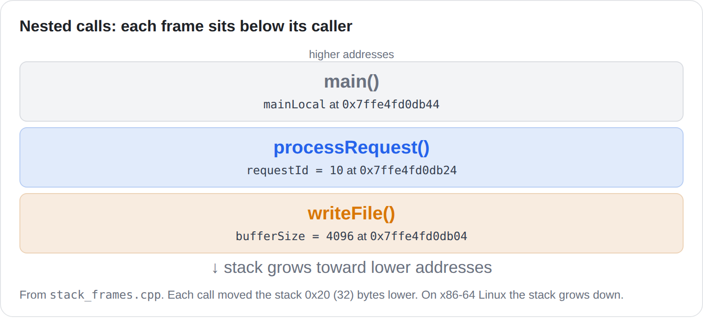

Every call moved 32 bytes lower. On x86-64 Linux the stack grows toward lower addresses, so "on top of the stack" means "at a lower address".

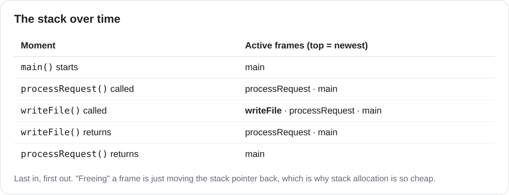

When `writeFile()` returns, its frame stops being active; when `processRequest()` returns, so does that one. Nothing is "freed" in the allocator sense. The stack pointer just moves back, which is why stack allocation is so cheap.

### The catch: the stack is small

```cpp
void processFile() {
    char buffer[100 * 1024 * 1024];   // 100 MB
    buffer[0] = 'x';
}
```

`ulimit -s` on my machine says `8192`, so the main thread gets 8 MiB of stack. This array is more than twelve times that:

```text
calling processFile()
./run.sh: line 14: 47318 Segmentation fault      (core dumped) ./stack_overflow
exit status: 139
```

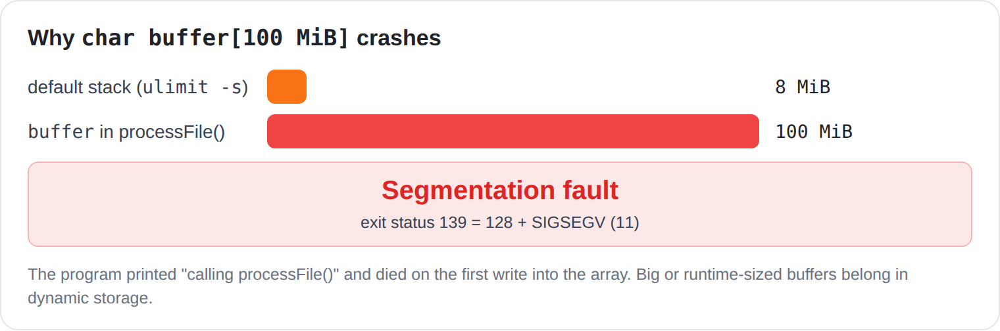

139 is 128 + 11, and 11 is `SIGSEGV`. The array never fit, and the first write into it touched memory below the end of the stack.

## 3. The heap: memory you ask for at runtime

A storage server doesn't know how big the next file is until the request arrives, so a fixed-size local buffer doesn't work. That's what dynamic allocation is for:

```cpp
int fileSize;
std::cin >> fileSize;
char* buffer = new char[fileSize];
```

- `buffer` is a pointer variable, and a local one.
- `new char[fileSize]` dynamically allocates an array of `fileSize` chars.
- The array has dynamic storage duration: it stays alive until it is deallocated.

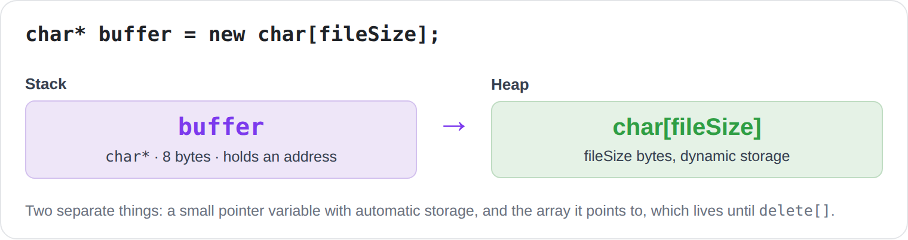

The pointer and the array are two separate things, with separate lifetimes. That's the same point Phase 1 made with pointers in general:

```cpp
int x = 10;             // a local int
int* p = &x;            // a pointer to that local
int* q = new int(20);   // a pointer to a dynamically allocated int
```

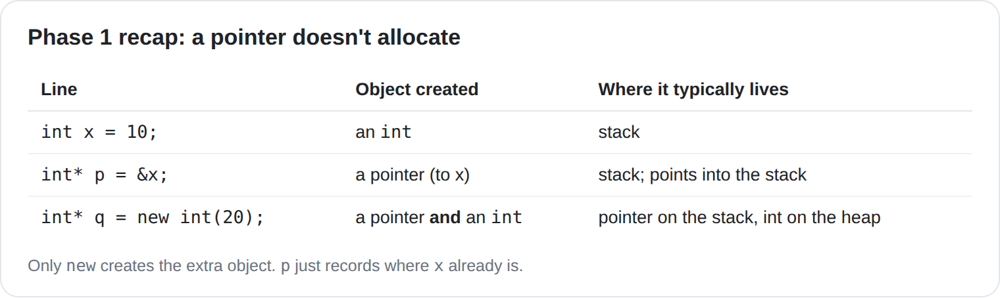

`p` doesn't allocate anything. Only `q` points at an object that was created with `new`.

### Who cleans the heap up?

With manual memory management, I do:

```cpp
char* buffer = new char[4096];
// use the buffer
delete[] buffer;
```

Without the `delete[]`, the array is never released: a memory leak. Module 3 measures one.

## 4. The other regions

I don't need to know every region in detail yet, but I want to recognise them in a `/proc/self/maps` dump.

| Region | Holds | From `regions.cpp` |
|---|---|---|
| Text | the compiled machine instructions | `writeFile` |
| Data | globals and statics with an initial value | `int totalFiles = 100;` |
| BSS | globals and statics that start out as zero | `int totalErrors;` |
| Memory-mapped | shared libraries, files mapped with `mmap()` | `libc.so.6` |

The `size` tool shows how big each section of the executable is:

```text
   text	   data	    bss	    dec	    hex	filename
  24825	    936	    288	  26049	   65c1	regions
```

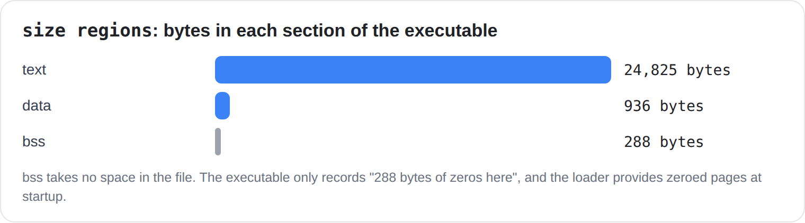

BSS exists so the file doesn't have to store zeros. The executable only records "288 bytes of zeros go here", and the loader hands the process zeroed pages at startup.

The memory-mapped region is where Linux `mmap()` places files mapped into the address space. That comes back in Phase 5 when I look at Linux I/O and storage performance.

## 5. Stack vs heap

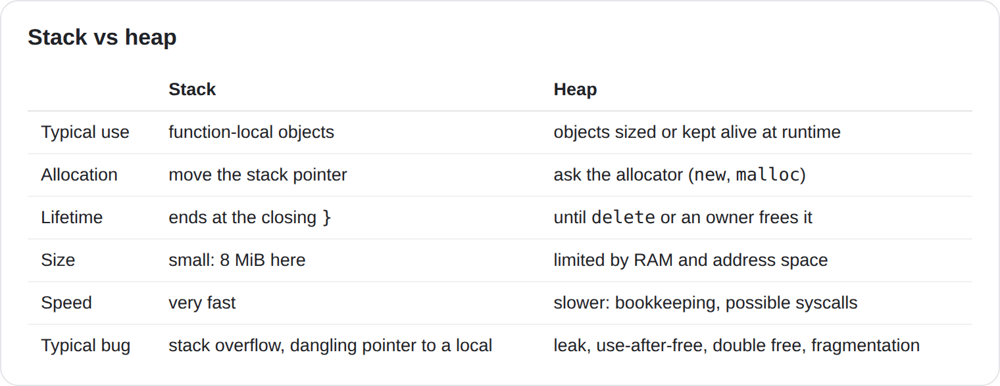

One correction to my own wording in this module: the C++ standard never says "stack" or "heap". Those are how implementations usually work. What the standard actually specifies is storage durations and object lifetimes.

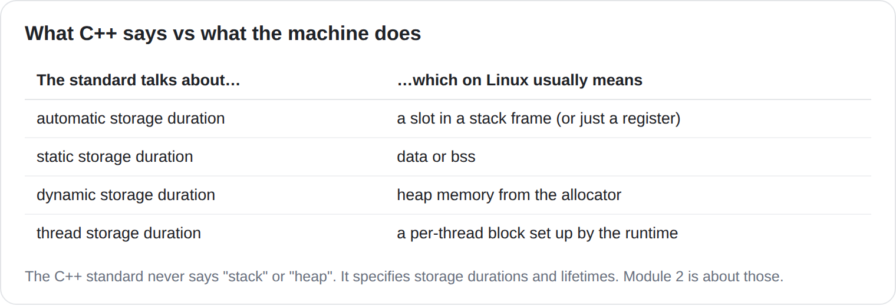

That's what Module 2 is about.

---

Next: [Module 2, object lifetime and storage duration](../02-object-lifetime-storage-duration/).
