# Module 2: Object lifetime and storage duration

Module 1 ended on a correction: "stack" and "heap" are implementation words, and the C++ standard talks about storage duration and lifetime instead. This module is about those, plus scope, because the three get mixed up all the time. They often line up for ordinary locals, which is exactly what makes them easy to confuse.

All the code is in [`examples/`](examples/). `./run.sh` runs every example, runs the dangling pointer under AddressSanitizer, then rebuilds `scope_lifetime.cpp` with `-DSHOW_ERRORS` to show the scope error. The output is from GCC 11 on x86-64 Linux.

| File | What it shows | Run it |
|---|---|---|
| [`scope_lifetime.cpp`](examples/scope_lifetime.cpp) | Scope, and a pointer that dies before the object it points to | [Compiler Explorer](https://godbolt.org/z/xj97qfbbo) |
| [`storage_durations.cpp`](examples/storage_durations.cpp) | Automatic, static, dynamic and thread storage, traced | [Compiler Explorer](https://godbolt.org/z/jMd6T49oT) |
| [`dangling.cpp`](examples/dangling.cpp) | Reading through a pointer after `delete` (broken on purpose) | [Compiler Explorer](https://godbolt.org/z/7e8KMGxxo) |

---

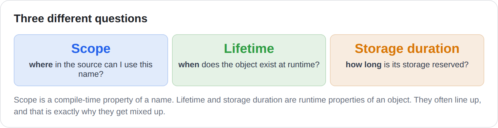

## 1. Scope: where can I use a name?

```cpp
void processRequest() {
    int requestId = 10;

    if (requestId > 0) {
        int retryCount = 3;
        std::cout << retryCount;
    }

    // retryCount can't be used here
}
```

`requestId` is in scope for the whole function. `retryCount` is only in scope inside the `if` block. Scope is about the source code: which names the compiler lets me write at a given line. If I try anyway:

```text
scope_lifetime.cpp:16:18: error: ‘retryCount’ was not declared in this scope
```

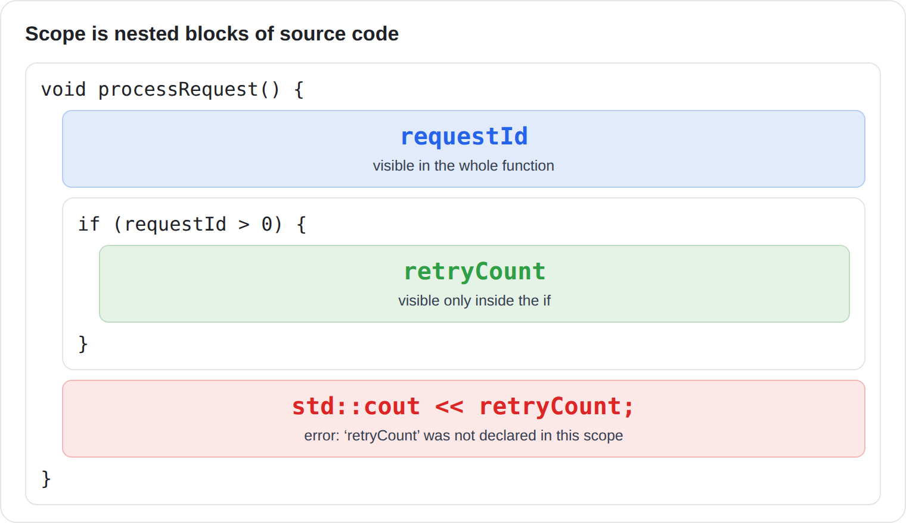

## 2. Lifetime: when does an object exist?

```cpp
void processRequest() {
    int requestId = 10;
    {
        int retryCount = 3;
    }
    // retryCount's lifetime has ended
}
```

When execution leaves the inner block, the lifetime of `retryCount` ends. For an ordinary local like this, scope and lifetime start and stop at the same braces. But they are different things, and dynamic allocation pulls them apart:

```cpp
int* createBuffer() {
    int* buffer = new int(100);
    return buffer;
}
```

When `createBuffer()` returns, the local pointer `buffer` stops existing. The int it pointed to does not. The returned pointer is a copy of its address, so the caller can still reach it. In my run:

```text
  inside createBuffer: &buffer = 0x7ffcbde78ca0, buffer = 0x6520c18b5ec0
  back in main:        p = 0x6520c18b5ec0, *p = 100
```

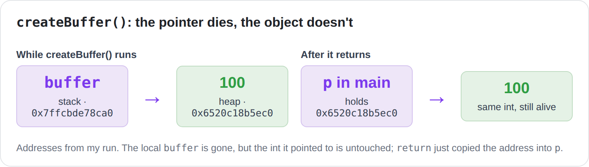

An allocated object doesn't die just because the pointer that first referred to it went out of scope. That's the distinction this whole phase keeps coming back to.

## 3. Storage duration: how long is the storage there?

C++ has four storage durations.

### Automatic

```cpp
void process() {
    int requestId = 10;
}
```

Tied to the enclosing block. In practice this is the stack frame from Module 1, or just a register.

### Static

```cpp
int totalRequests = 0;

void process() {
    static int retryCount = 0;
    int calls = 0;
    ++retryCount;
    ++calls;
}
```

`totalRequests` and `retryCount` both have static storage duration: they exist until the program ends. `retryCount` is declared inside the function, so its scope is the function, but it isn't destroyed when the function returns. It's initialised the first time control passes through the declaration and keeps its value after that. `calls` is the automatic version for comparison:

```text
  process(): retryCount = 1, calls = 1
  process(): retryCount = 2, calls = 1
  process(): retryCount = 3, calls = 1
```

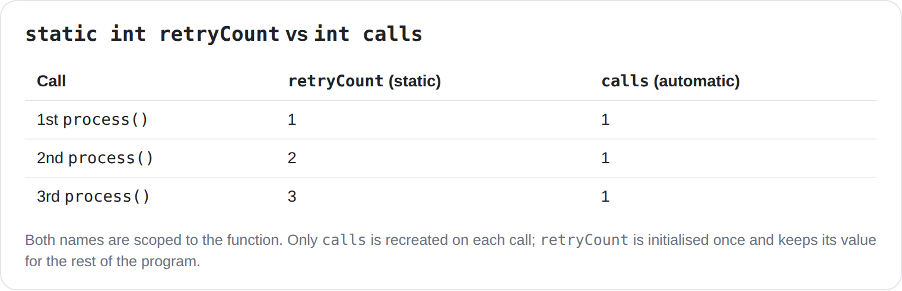

### Dynamic

```cpp
int* buffer = new int(100);
```

The int has dynamic storage duration. It lives until it is explicitly destroyed with `delete`, or until something that owns it does that for me (Module 4).

### Thread

```cpp
thread_local int requestCount = 0;
```

Every thread gets its own `requestCount`, created for that thread and destroyed when it exits. In `storage_durations.cpp` two threads increment it 3 and 5 times at the same time, and nobody steps on anybody:

```text
  thread A: requestCount = 3 at 0x7f6b45bff63c
  thread B: requestCount = 5 at 0x7f6b453fe63c
  main:     requestCount = 0 at 0x7f6b463003bc
```

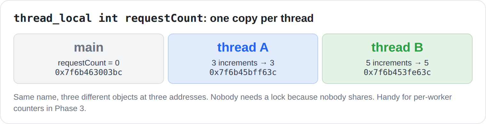

Same name, three objects. That will be useful for per-worker counters in Phase 3.

## 4. All four at a glance

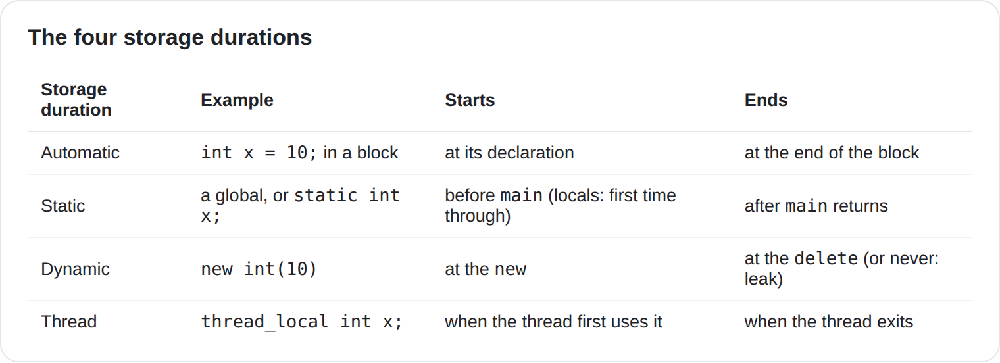

`storage_durations.cpp` puts a small `Tracer` in each kind of storage that prints `+` when it's constructed and `-` when it's destroyed:

```text
  + static: global
main starts
automatic
  + automatic: block local
  - automatic: block local
...
dynamic
  + dynamic: new
  ...still alive after the line that created it
  - dynamic: new
...
main ends
  - static: global
```

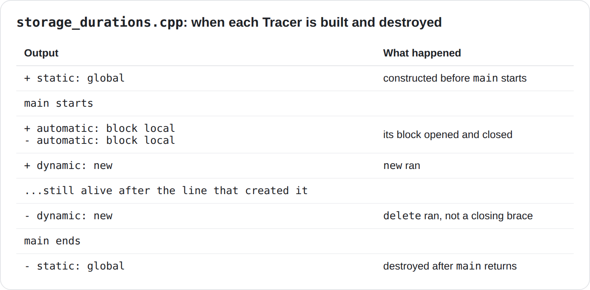

The global is built before `main` starts and destroyed after it ends. The block local lasts exactly as long as its braces. The dynamic one is destroyed on the `delete` line, not at any closing brace.

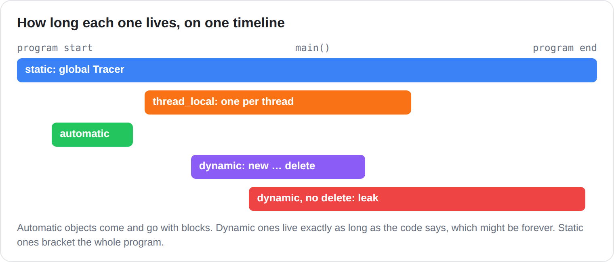

## 5. Lifetime vs memory: what `delete` actually does

```cpp
int* p = new int(50);
delete p;
std::cout << *p;   // undefined behaviour
```

After `delete p`:

- the int's lifetime has ended,
- its storage has been handed back to be reused,
- the pointer variable `p` still exists,
- and `p` still holds the old address, so it's dangling.

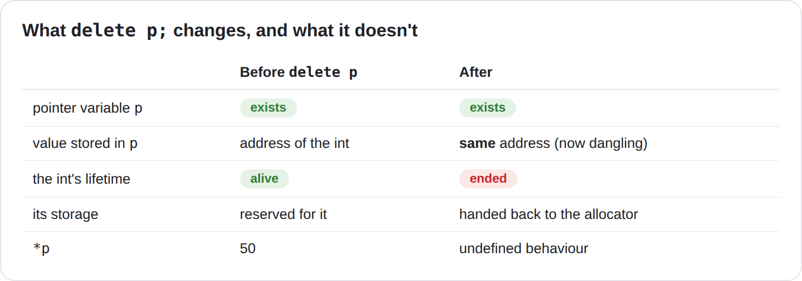

The pointer didn't disappear. It just doesn't point at a live object any more. That's why people write:

```cpp
delete p;
p = nullptr;
```

Now an accidental `*p` dereferences a null pointer instead of reading freed memory. But it only fixes that one variable. `dangling.cpp` makes a second pointer to the same int, clears the first and reads through the second:

```cpp
int* p = new int(50);
int* copy = p;
delete p;
p = nullptr;
std::cout << *copy << '\n';
```

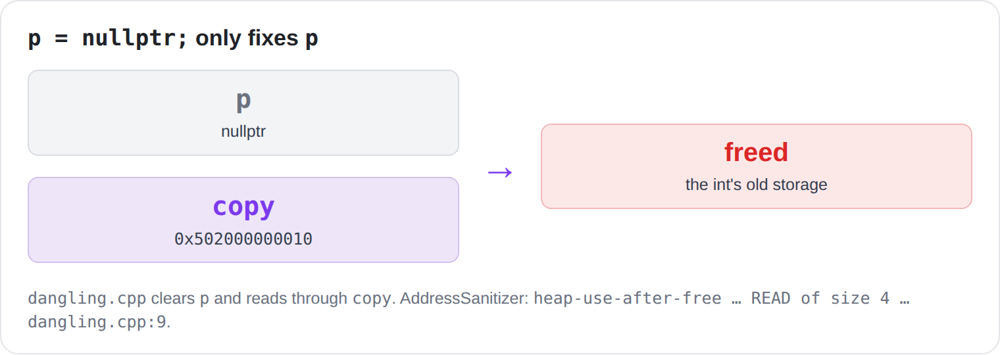

AddressSanitizer catches it:

```text
ERROR: AddressSanitizer: heap-use-after-free on address 0x502000000010
READ of size 4 at 0x502000000010 thread T0
    #0 main dangling.cpp:9
freed by thread T0 here:
    #1 main dangling.cpp:7
previously allocated by thread T0 here:
    #1 main dangling.cpp:5
SUMMARY: AddressSanitizer: heap-use-after-free dangling.cpp:9 in main
```

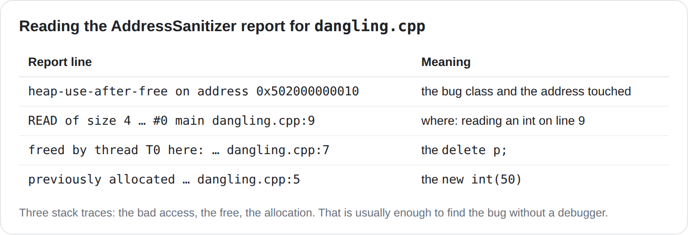

Three locations: the bad read, the `delete`, and the `new`. Module 3 looks at what this bug does without a sanitizer.

---

Next: [Module 3, dynamic memory allocation](../03-dynamic-memory-allocation/).
