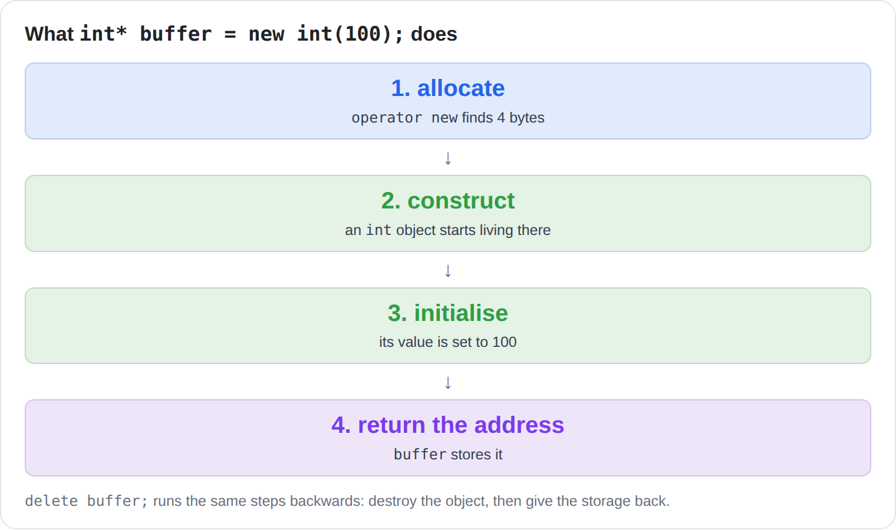
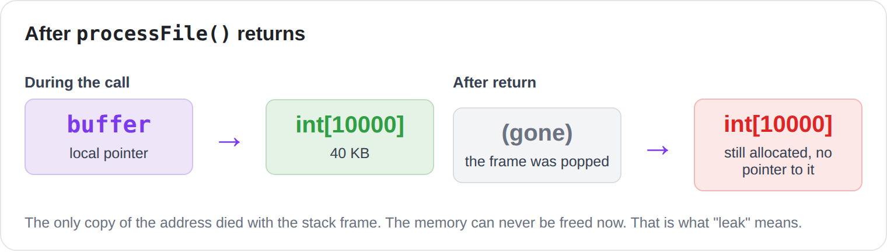
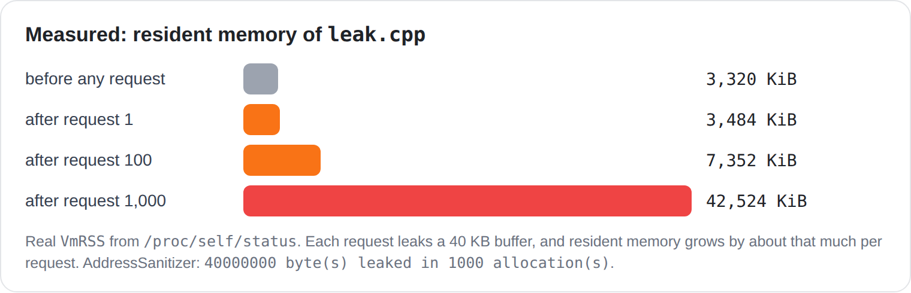
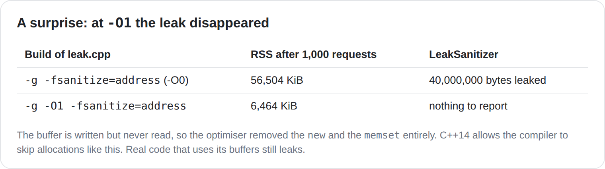
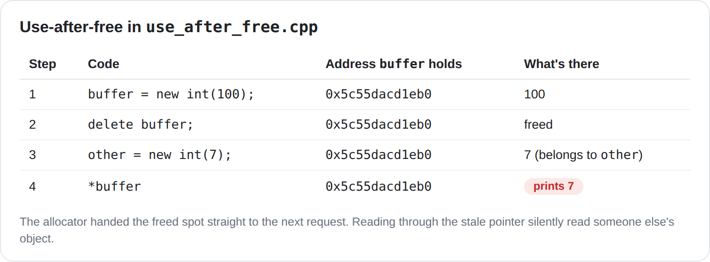
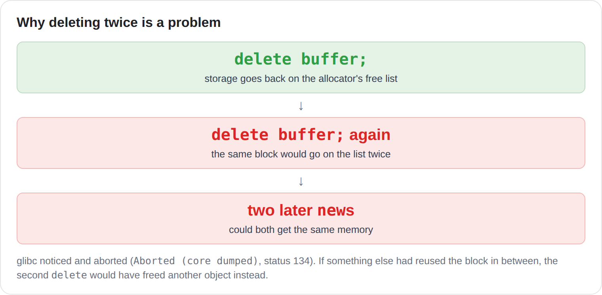
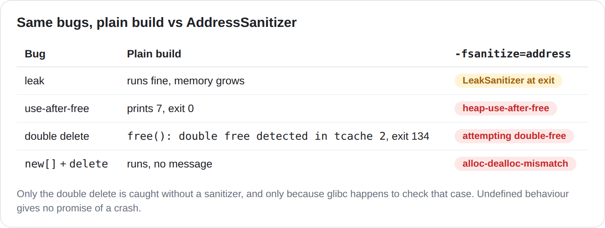
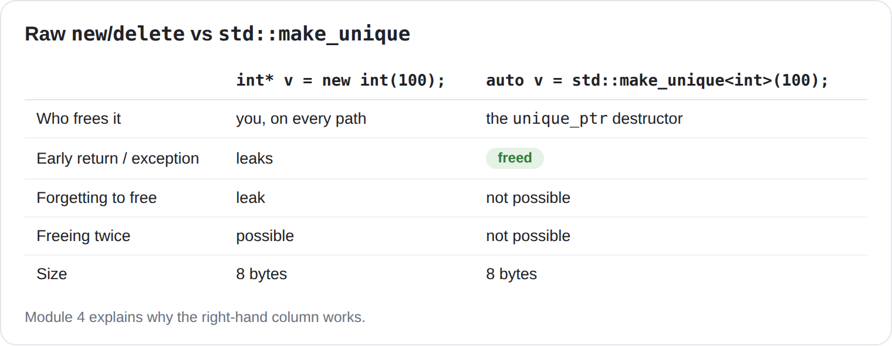

# Module 3: Dynamic memory allocation

Back to the storage server. A client uploads a 2 GB file and I need a buffer to process it. Module 1 showed that an 8 MiB stack can't take even 100 MB, so this has to come from dynamic storage. This module is about how `new` and `delete` work, and the four ways I can get them wrong.

All the code is in [`examples/`](examples/). `./run.sh` runs every example, runs the broken ones plainly and under AddressSanitizer, and shows one leak that the optimiser removed. The output is from GCC 11 on x86-64 Linux.

| File | What it shows | Run it |
|---|---|---|
| [`new_delete.cpp`](examples/new_delete.cpp) | `new`/`delete` and `new[]`/`delete[]`; `-DMISMATCH` mixes them up | [Compiler Explorer](https://godbolt.org/z/e4YYdr4vK) |
| [`leak.cpp`](examples/leak.cpp) | 1,000 requests that each leak 40 KB, with resident memory measured | [Compiler Explorer](https://godbolt.org/z/qh84h9d6n) |
| [`use_after_free.cpp`](examples/use_after_free.cpp) | Reading an int after `delete` (broken on purpose) | [Compiler Explorer](https://godbolt.org/z/nTrYGqvP6) |
| [`double_delete.cpp`](examples/double_delete.cpp) | Deleting the same int twice (broken on purpose) | [Compiler Explorer](https://godbolt.org/z/G391bPTfr) |

---

## 1. What `new` actually does

```cpp
int* buffer = new int(100);
```

There are two separate things on this line. `new int(100)`:

1. asks for enough storage for an `int`,
2. creates an `int` object in that storage,
3. initialises it to 100,
4. produces a pointer to it.

Then `int* buffer = ...` stores that address in a pointer variable.




`new` creates an object. A pointer just stores where it is. Where the pointer itself lives depends on where it's declared; here it's a local.

## 2. `new` vs `new[]`

One object:

```cpp
int* value = new int(100);
std::cout << *value;   // 100
delete value;
```

An array of objects:

```cpp
int* buffer = new int[5];
for (int i = 0; i < 5; ++i) {
    buffer[i] = (i + 1) * 10;
}
delete[] buffer;
```

```text
*value = 100
buffer = 10 20 30 40 50
```

![Five ints in 20 contiguous bytes, buffer[0] to buffer[4]](images/04-array-layout.png)

Each form has its own release, and mixing them is undefined behaviour:

![new pairs with delete, new[] with delete[], malloc with free](images/03-new-vs-new-array.png)

Building `new_delete.cpp` with `-DMISMATCH` swaps `delete[] buffer` for `delete buffer`. The plain build runs with no message. AddressSanitizer doesn't let it go:

```text
ERROR: AddressSanitizer: alloc-dealloc-mismatch (operator new [] vs operator delete) on 0x503000000040
```

## 3. Forgetting to deallocate: a leak

```cpp
void processFile() {
    int* buffer = new int[10000];                     // 40 KB per call
    std::memset(buffer, 0, 10000 * sizeof(int));
}
```

There's no `delete[]`. When the function returns, the local pointer is gone with its frame, but the array is still allocated. The only copy of its address was in that pointer, so there is now no way to free it.



`leak.cpp` calls this 1,000 times and reads its own resident memory (`VmRSS` from `/proc/self/status`) as it goes. The `memset` makes sure the pages are really used and not just reserved.

```text
before any request: 3320 KiB resident
after request 1: 3484 KiB resident
after request 100: 7352 KiB resident
after request 1000: 42524 KiB resident
```



Roughly 40 KB more for every request, and none of it ever comes back. LeakSanitizer adds it up at exit:

```text
Direct leak of 40000000 byte(s) in 1000 object(s) allocated from:
SUMMARY: AddressSanitizer: 40000000 byte(s) leaked in 1000 allocation(s).
```

In a short program that's harmless, because the OS reclaims everything at exit. A storage server doesn't exit. It can look fine for minutes and then slowly eat RAM until the kernel's OOM killer picks it, or something else on the machine.

### The leak that wasn't there at `-O1`

Build the same sanitizer run with `-O1` and LeakSanitizer says nothing. Resident memory stays flat too:



The buffer is written but never read, so at `-O1` GCC removed the `new` and the `memset` completely. Since C++14 the compiler is allowed to skip a `new`/`delete` allocation like this. So `run.sh` runs the sanitizer at `-O0`, and keeps the `-O1` run at the end to show the difference. A real buffer that's actually used still leaks.

## 4. Using memory after it's released

```cpp
int* buffer = new int(100);
delete buffer;
int* other = new int(7);
std::cout << *buffer;
```

This is a use-after-free: reading an object whose lifetime has ended. I added a second allocation in between, and the plain build shows why it's so nasty:

```text
buffer = 0x5c55dacd1eb0, other = 0x5c55dacd1eb0
*buffer = 7
```



The allocator gave the freed spot straight to the next request. `*buffer` didn't crash or print garbage. It printed 7, a valid-looking value that belongs to a different object. If this were a write instead of a read, it would silently corrupt `other`. Undefined behaviour can print the wrong value, crash, seem to work, or corrupt unrelated data, and this one picked "seem to work". AddressSanitizer catches it:

```text
ERROR: AddressSanitizer: heap-use-after-free on address 0x502000000010
READ of size 4 at 0x502000000010 thread T0
    #0 main use_after_free.cpp:9
freed by thread T0 here:
    #1 main use_after_free.cpp:6
previously allocated by thread T0 here:
    #1 main use_after_free.cpp:5
```

Setting `buffer = nullptr;` right after the `delete` would have helped here, but as Module 2 showed, it only clears that one pointer and not any copies of it.

## 5. Deleting twice

```cpp
int* buffer = new int(100);
delete buffer;
delete buffer;   // undefined behaviour
```

This one glibc happens to check for:

```text
deleted once
free(): double free detected in tcache 2
Aborted (core dumped)
exit status: 134
```



The danger is that the block goes on the allocator's free list twice, and two later `new`s could get the same memory. Or, if something reused the block in between, the second `delete` frees somebody else's object. glibc's check is a safety net, not a guarantee. AddressSanitizer reports `attempting double-free` with both `delete` lines.



That table is why I run new code under `-fsanitize=address`. Out of four bugs, the plain build only flagged one.

## 6. So why not use raw `new` everywhere?

Every bug in this module comes from the same place: a human has to remember to call `delete`, exactly once, on every path, with the right form, and never touch the pointer again. That gets hard fast in a large system with early returns and exceptions. Modern C++ mostly doesn't write it by hand:

```cpp
#include <memory>

auto value = std::make_unique<int>(100);
```



Now an object owns the allocation and frees it in its destructor. Why that's reliable is Module 4.

---

Next: [Module 4, RAII](../04-raii/).
