# Module 4: RAII (Resource Acquisition Is Initialization)

Module 3 ended with every bug coming back to one thing: a person has to remember the cleanup on every path. RAII is how C++ takes that job away from the person and gives it to an object's lifetime. Phase 1 Module 8 had a first version of this with `StorageFile`. This module is about why it works, and where it stops working.

All the code is in [`examples/`](examples/). `./run.sh` runs every example, rebuilds `unique_ptr.cpp` with `-DSHOW_ERRORS` to show the copy error, and runs `process_file.cpp` under AddressSanitizer. The output is from GCC 11 on x86-64 Linux.

| File | What it shows | Run it |
|---|---|---|
| [`fd_leak.cpp`](examples/fd_leak.cpp) | Counting leaked file descriptors: manual cleanup vs a `File` class | [Compiler Explorer](https://godbolt.org/z/4d1eYoMrx) |
| [`raii_file.cpp`](examples/raii_file.cpp) | The destructor runs while an exception unwinds the stack | [Compiler Explorer](https://godbolt.org/z/4e4GGz3c4) |
| [`lock_guard.cpp`](examples/lock_guard.cpp) | A mutex left locked by an exception, and `std::lock_guard` | [Compiler Explorer](https://godbolt.org/z/xK8hTjd9f) |
| [`unique_ptr.cpp`](examples/unique_ptr.cpp) | `make_unique`, arrays, moving ownership, and its size | [Compiler Explorer](https://godbolt.org/z/vPG3Gq6E4) |
| [`caveats.cpp`](examples/caveats.cpp) | `return` vs `std::exit` vs `std::abort`: which destructors run | [Compiler Explorer](https://godbolt.org/z/Mxz5n18sq) |
| [`process_file.cpp`](examples/process_file.cpp) | Raw `new[]` vs `unique_ptr` + `vector` in one request handler | [Compiler Explorer](https://godbolt.org/z/o8MebbhEa) |

---

## 1. The problem: functions don't always leave by the bottom

The storage server opens a file descriptor, writes, and closes it:

```cpp
void writeFile() {
    int fd = openFile();
    // write data
    closeFile(fd);
}
```

That's fine until something goes wrong:

```cpp
void writeFile() {
    int fd = openFile();
    if (someError) {
        return;                                    // fd leaks
    }
    throw std::runtime_error("Write failed");      // fd leaks
    closeFile(fd);                                 // never reached
}
```

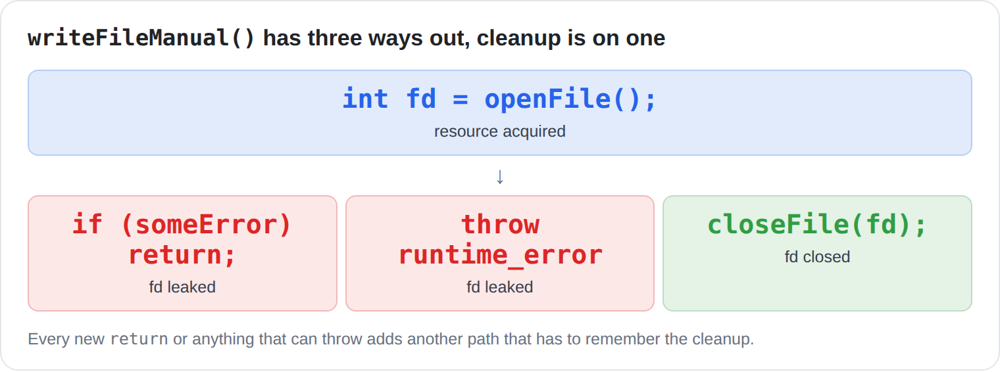

`openFile()` and `closeFile()` here are stand-ins, not standard functions. In `fd_leak.cpp` they're real `open()` and `close()` calls, and the program counts its own open descriptors in `/proc/self/fd`. It calls the manual version 30 times: 10 normal, 10 early returns, 10 exceptions, then does the same with the RAII version.

```text
manual: open fds before = 4, after 30 calls = 24
RAII  : open fds before = 24, after 30 calls = 24
```

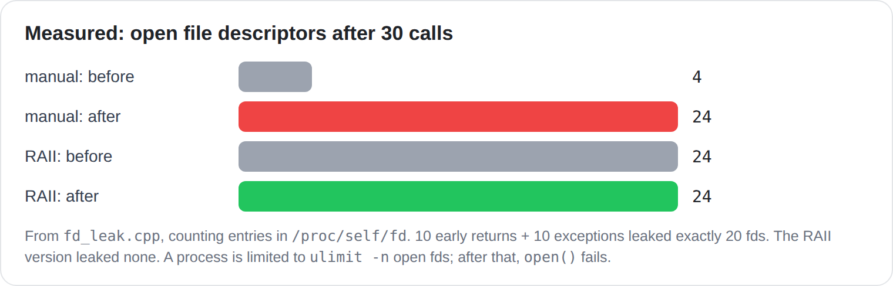

Exactly 20 leaked, one per early return and one per exception. The RAII run starts at 24 because the manual run's leaks are still open. A process has a limit on open descriptors (`ulimit -n`), and once it hits it, every `open()` and `accept()` fails. For a server that's an outage. The second line is the fix, and the rest of this module explains it.

## 2. The idea

RAII stands for Resource Acquisition Is Initialization. The name is awkward but the rule is short:

> Acquire the resource in an object's constructor. Release it in that object's destructor.

The reason this works is a guarantee C++ already makes: an object with automatic storage duration is destroyed when its scope exits, however it exits. A normal return, an early `return`, or an exception unwinding the stack (Phase 1 Module 10) all run the destructor.

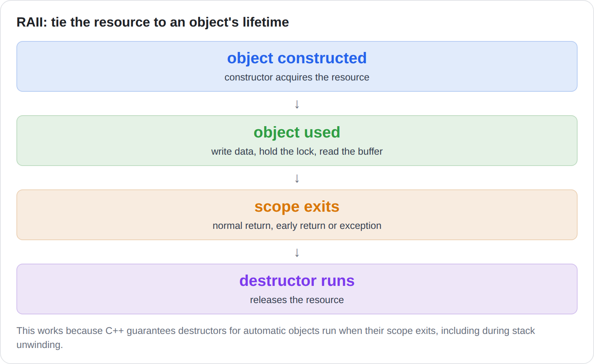

```cpp
class File {
public:
    File() : fd(openFile()) { std::cout << "File opened\n"; }
    ~File() {
        closeFile(fd);
        std::cout << "File closed\n";
    }

    File(const File&) = delete;
    File& operator=(const File&) = delete;

private:
    int fd;
};

void writeFile() {
    File file;
    std::cout << "Writing data\n";
    throw std::runtime_error("Write failed");
}
```

```text
File opened
Writing data
File closed
caught: Write failed
```

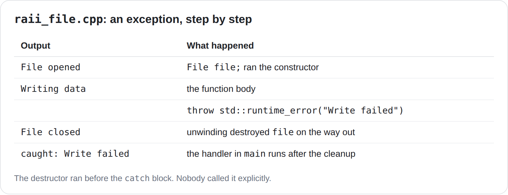

`File closed` comes before `caught`. The destructor ran while the exception was on its way out of `writeFile()`, before the handler in `main` got control. Nobody called it explicitly.

The two `= delete` lines are there for the same reason as in Phase 1: a copy of `File` would hold the same fd, and both destructors would close it. Copying and moving resource owners properly comes later in this phase.

## 3. RAII isn't only about memory

A resource is anything that has to be given back:

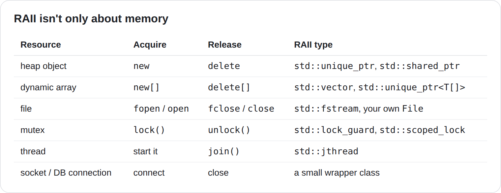

The standard library already wraps most of them. Locking a mutex is a good example, because forgetting to unlock is even worse than forgetting to free:

```cpp
std::mutex storageMutex;

void updateGuarded() {
    std::lock_guard<std::mutex> lock(storageMutex);
    throw std::runtime_error("metadata update failed");
}

void updateManual() {
    storageMutex.lock();
    throw std::runtime_error("metadata update failed");
    storageMutex.unlock();                          // never reached
}
```

`lock_guard.cpp` throws inside each one and then checks whether anyone else could take the lock with `try_lock()`:

```text
lock_guard: mutex free after the exception? yes
manual    : mutex free after the exception? no, still locked
```

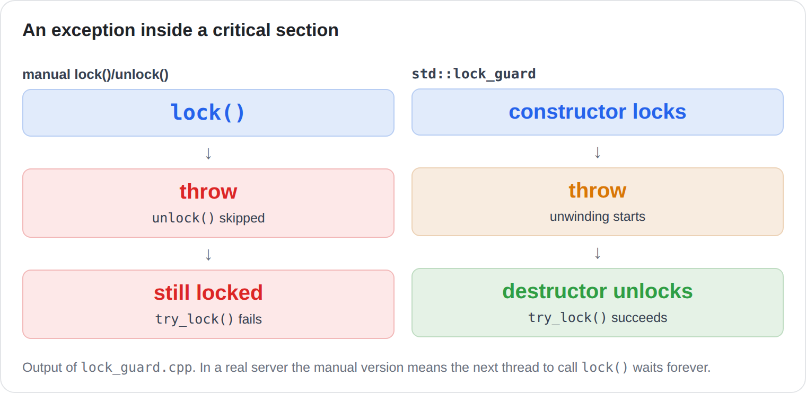

`lock_guard`'s constructor locks, its destructor unlocks, and there's no `unlock()` for me to forget. With the manual version, the next thread that calls `lock()` would wait forever. This comes back a lot in Phase 3.

## 4. `std::unique_ptr`: RAII for heap memory

The leak from Module 3, written the "careful" way, still leaks on the exception path:

```cpp
void processFile() {
    int* buffer = new int[1000];
    // if anything here throws, the delete[] never runs
    delete[] buffer;
}
```

`std::unique_ptr` is a small object that owns a heap allocation and deletes it in its destructor:

```cpp
void processFile() {
    auto buffer = std::make_unique<Buffer>(1);
    auto block = std::make_unique<int[]>(1000);    // the array form uses delete[]
    block[0] = 42;
}   // both freed here
```

```text
  allocate buffer 1
  using buffer 1, block[0] = 42
  free buffer 1
```

### Exclusive ownership

A `unique_ptr` is the only owner of its object, so it can't be copied:

```cpp
auto first = std::make_unique<Buffer>(2);
auto copy = first;   // doesn't compile
```

```text
error: use of deleted function ‘std::unique_ptr<_Tp, _Dp>::unique_ptr(const std::unique_ptr<_Tp, _Dp>&) [with _Tp = Buffer; _Dp = std::default_delete<Buffer>]’
```

It's the same `= delete` trick as `File`. Ownership can be handed over with `std::move` instead:

```cpp
auto second = std::move(first);
```

```text
  first is empty (nullptr), second owns buffer 2
```

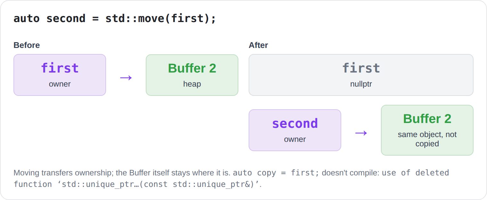

The `Buffer` doesn't move or get copied. Only the pointer inside changes hands, and `first` is left empty. Buffer 2 is freed once, when `second` goes out of scope at the end of `main`.

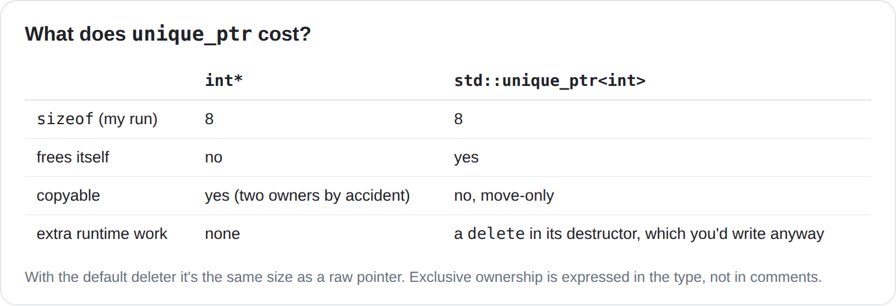

`sizeof(std::unique_ptr<int>)` is 8 in my run, the same as `int*`. The safety costs no space with the default deleter. Smart pointers and ownership get the full treatment in Modules 5–7.

## 5. What RAII does and doesn't guarantee

The chain is: object constructed → resource acquired → object used → object destroyed → resource released. The cleanup happens when the owning object is properly destroyed. Everything depends on that "properly". `caveats.cpp` has a local and a static `Tracer` and leaves `main` three different ways:

```text
leaving main with return
  destructor: local object
  destructor: static object
  exit status: 0
leaving main with exit
  destructor: static object
  exit status: 0
leaving main with abort
  exit status: 134
```

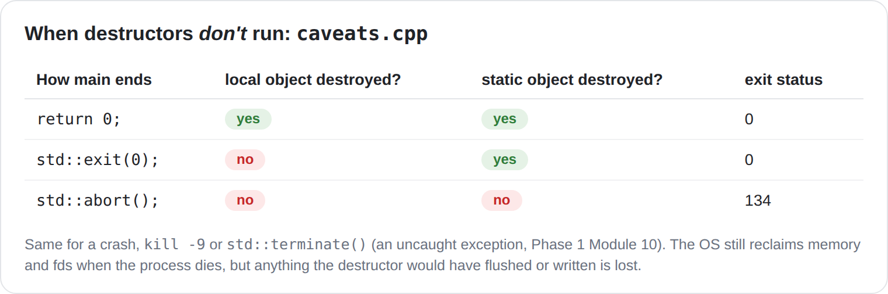

- `std::exit()` destroys static objects but not the locals of the function that called it.
- `std::abort()`, a crash, `kill -9`, and `std::terminate()` (an uncaught exception) run no destructors at all.
- The destructor has to actually release the resource, correctly.
- The object has to actually own the resource. Two objects that both think they own it (the copy problem) is a bug.

The OS still takes back memory and file descriptors when a process dies, so those aren't lost. But anything a destructor would have flushed, written or told another machine is. RAII isn't magic. It's a way of designing ownership so that cleanup follows lifetime.

## 6. Modules 1–4 in one function

```cpp
void processFile() {
    int fileSize = 4096;                                // automatic
    auto buffer = std::make_unique<char[]>(fileSize);   // owns a heap array
    std::vector<int> metadata(100);                     // owns its own heap storage
    std::cout << "Processing file (unique_ptr + vector)\n";
}
```

When it returns, the locals are destroyed in reverse order of construction, and each one releases what it owns:

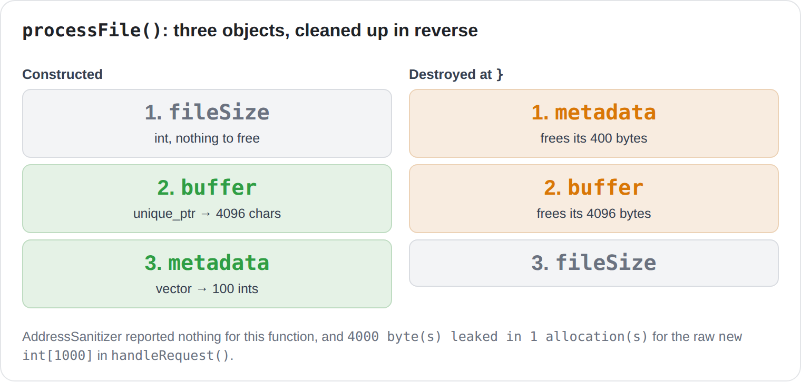

`process_file.cpp` puts it next to the same handler written with a raw `new[]` and no `delete[]`, and runs both under AddressSanitizer:

```cpp
void handleRequest() {
    int requestId = 10;
    int* buffer = new int[1000];
    std::cout << "Processing request\n";
}
```

```text
Processing request 10 (raw new[])
Processing file (unique_ptr + vector)
Direct leak of 4000 byte(s) in 1 object(s) allocated from:
    #1 handleRequest() process_file.cpp:7
SUMMARY: AddressSanitizer: 4000 byte(s) leaked in 1 allocation(s).
```

In `handleRequest()`, `requestId` and the pointer `buffer` are both automatic, so both are gone when the function returns. The 1,000-int array is dynamic, nothing owns it, and it leaks: 4,000 bytes, reported at line 7. `processFile()` does the same work and leaks nothing.

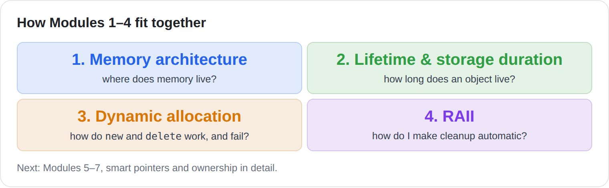

---

Next: Module 5, smart pointers and ownership.
