# Module 5: Ownership and resource management

Modules 1–4 were about where memory lives, how long objects live, and how RAII ties cleanup to a scope. That still leaves one question open, and it comes up as soon as more than one function touches the same buffer:

> When several parts of a program can reach the same object, who is responsible for destroying it?

This module is about that question on its own, before any smart pointers. Modules 6 and 7 are the C++ answers to it.

All the code is in [`examples/`](examples/). `./run.sh` builds both examples, runs the three ownership mistakes under AddressSanitizer, and runs the borrowing version under AddressSanitizer to show it's clean. The output is from GCC 11 on x86-64 Linux.

| File | What it shows | Run it |
|---|---|---|
| [`ownership_bugs.cpp`](examples/ownership_bugs.cpp) | Three raw pointers to one buffer, and the three ways ownership goes wrong | [Compiler Explorer](https://godbolt.org/z/cPa69WfTa) |
| [`borrow.cpp`](examples/borrow.cpp) | One owner, two borrowers, no errors | [Compiler Explorer](https://godbolt.org/z/8b9KjxdPK) |

---

## 5.1 The problem: who owns the buffer?

A client uploads a file and my storage server allocates a buffer for it:

```cpp
int* buffer = new int[1000];
```

Three components need that buffer:

- `RequestHandler` receives the file.
- `ChecksumService` calculates its checksum.
- `StorageWriter` writes it to the SSD.

All three can reach it. So which one calls `delete[]`?

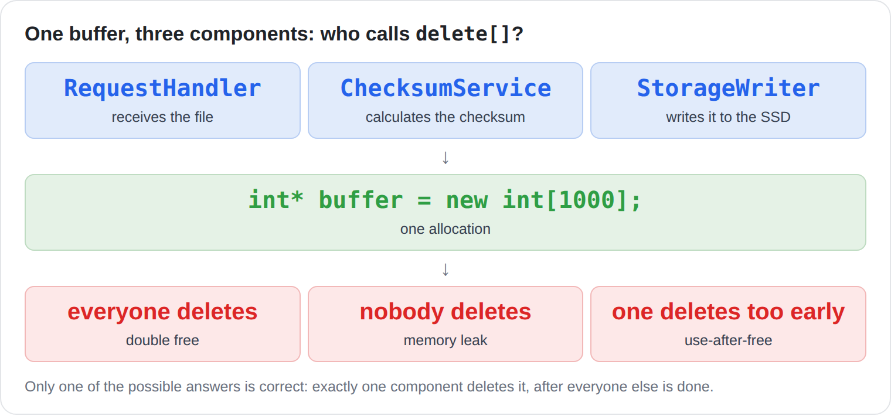

Every wrong answer is a bug I already met in Module 3. If everyone deletes it, it's a double free. If nobody does, it's a leak. If one component deletes it while another is still reading, it's a use-after-free. That's the ownership problem.

## 5.2 Access is not ownership

It helps to separate two words that are easy to treat as one:

- **Access** is being able to use an object: read it, write it, pass it on.
- **Ownership** is being responsible for ending its lifetime and releasing what it holds.

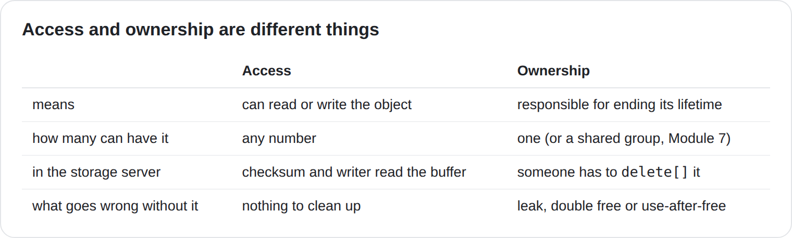

Here's what that looks like with raw pointers:

```cpp
int* buffer = new int[1000];

int* checksumBuffer = buffer;
int* writerBuffer = buffer;
```

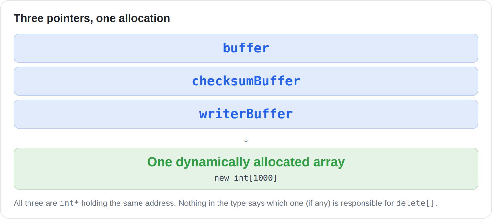

All three pointers give access. None of them says who owns the array. They're all `int*` with the same address, so the compiler can't tell them apart either, and that's the core weakness of using raw pointers for ownership.

`ownership_bugs.cpp` is exactly this setup. A command-line argument picks which component believes it owns the buffer:

```cpp
if (mistake == "nobody") {
    ChecksumService(checksumBuffer);
    StorageWriter(writerBuffer, false);   // nobody deletes
} else if (mistake == "everyone") {
    ChecksumService(checksumBuffer);
    delete[] buffer;                      // the handler deletes...
    StorageWriter(writerBuffer, true);    // ...and so does the writer
} else if (mistake == "early") {
    StorageWriter(writerBuffer, true);    // the writer deletes...
    ChecksumService(checksumBuffer);      // ...then checksum reads it
}
```

Under AddressSanitizer, trimmed to the lines that matter:

```text
--- nobody
Direct leak of 4000 byte(s) in 1 object(s) allocated from:
    #1 RequestHandler(std::basic_string_view<char, std::char_traits<char> >) ownership_bugs.cpp:23
SUMMARY: AddressSanitizer: 4000 byte(s) leaked in 1 allocation(s).
--- everyone
ERROR: AddressSanitizer: attempting double-free on thread T0:
    #1 StorageWriter(int*, bool) ownership_bugs.cpp:17
freed by thread T0 here:
    #1 RequestHandler(std::basic_string_view<char, std::char_traits<char> >) ownership_bugs.cpp:36
SUMMARY: AddressSanitizer: double-free ..asan_new_delete.cpp:163 in operator delete[](void*)
--- early
ERROR: AddressSanitizer: heap-use-after-free on address <address>
    #0 ChecksumService(int const*) ownership_bugs.cpp:8
freed by thread T0 here:
    #1 StorageWriter(int*, bool) ownership_bugs.cpp:17
SUMMARY: AddressSanitizer: heap-use-after-free ownership_bugs.cpp:8 in ChecksumService(int const*)
```

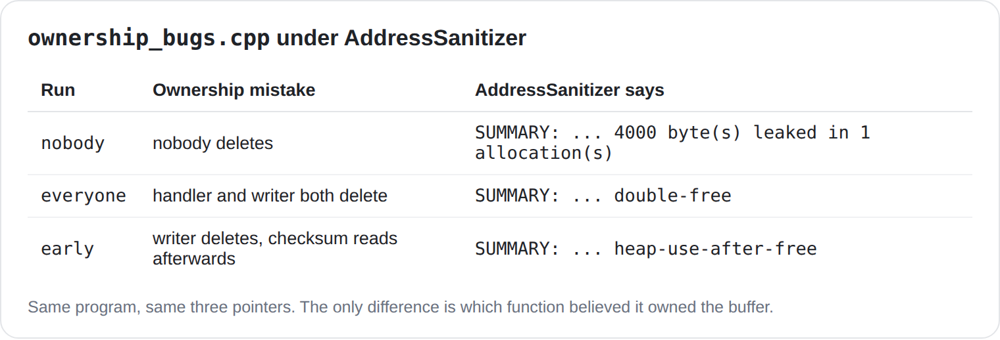

The program is the same each time, and so are the three pointers. The only thing that changes is which function thought it was the owner. The frames under "freed by" and "previously allocated" name the functions involved, which is the most useful part of these reports: they point at the ownership decision, not just the line that crashed.

## 5.3 One owner, several borrowers

The fix isn't to stop sharing. It's to decide that exactly one function owns the buffer and the others only borrow it:

```cpp
int calculateChecksum(const int* buffer, std::size_t size);   // borrows
void writeToDisk(std::span<const int> buffer);                // borrows

void processFile() {
    int* buffer = new int[1000];
    // fill it ...
    std::cout << "checksum: " << calculateChecksum(buffer, size) << '\n';
    writeToDisk(std::span<const int>(buffer, size));
    delete[] buffer;                                          // the owner frees it
}
```

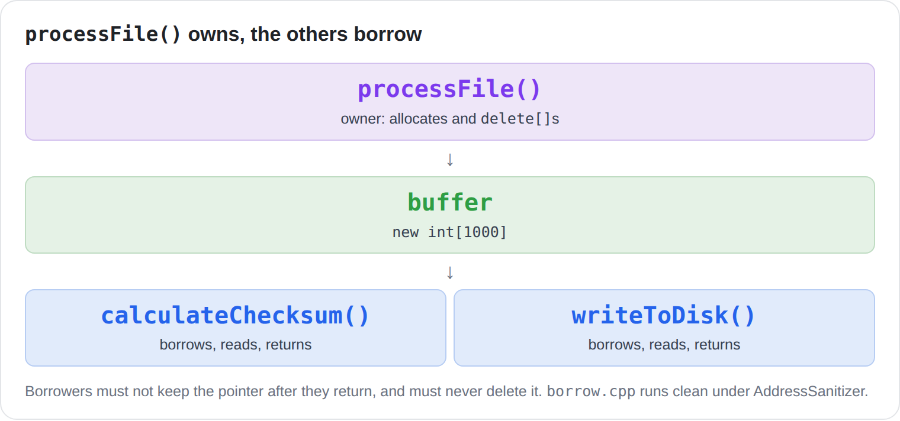

```text
checksum: 499500
wrote 4000 bytes
AddressSanitizer: no errors
```

This is a perfectly reasonable design, as long as the borrowers follow two rules: they don't keep the pointer after they return, and they never delete it. `const int*` also tells the reader the checksum won't modify the data.

`std::span` (C++20) is a pointer plus a length that never owns anything. I used it for `writeToDisk` because it carries the size with it, and nobody reading the signature will wonder whether they're supposed to free it.

The catch is that the compiler doesn't know `processFile()` is the owner. That's a convention in my head and maybe in a comment. If the next person adds an early `return` or a `throw` before `delete[]`, it's Module 4's leak again.

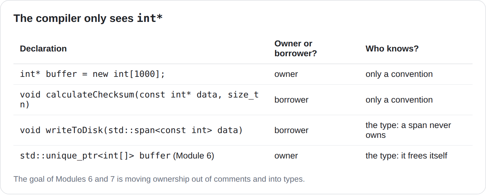

## 5.4 Three ownership models

Modern C++ code usually makes one of three choices, and each one has a type that says it:

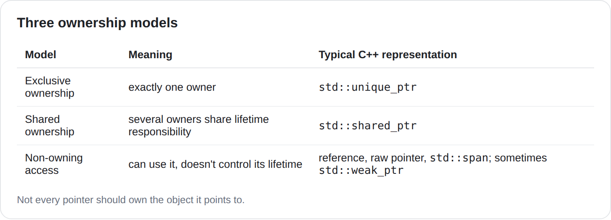

- **Exclusive ownership.** One component owns the object. When that owner is destroyed, so is the object. This is `std::unique_ptr` (Module 6).
- **Shared ownership.** Several components share responsibility, and the object stays alive while at least one of them still holds it. This is `std::shared_ptr` (Module 7).
- **Non-owning access.** A component uses the object but isn't responsible for destroying it. This is a reference, a raw pointer or a `std::span`, and sometimes a `std::weak_ptr` (also Module 7).

The rule I keep coming back to is that not every pointer should own the object it points to. Most pointers in a well-designed program are borrowers.

## 5.5 Ownership transfer

Sometimes ownership has to move. The request handler creates the buffer, but once it's handed over, the storage writer is responsible for it:

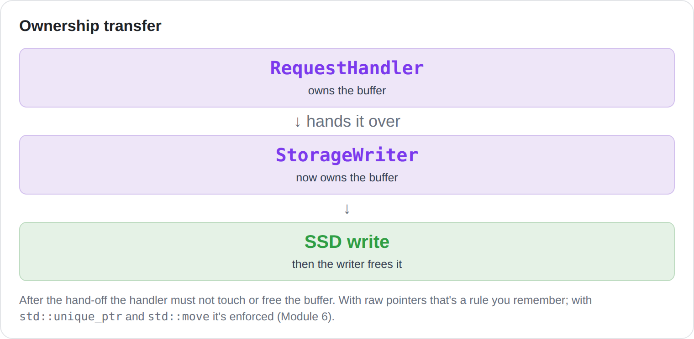

With raw pointers this is just another rule to remember: after the hand-off, the handler must not touch the buffer or free it. In Module 6 the same hand-off is written with `std::unique_ptr` and `std::move`, and the handler's pointer is empty afterwards, so it can't make that mistake.

## 5.6 Why this matters in a long-running server

A storage service can run for months and handle millions of requests, so a mistake that happens once per request adds up.

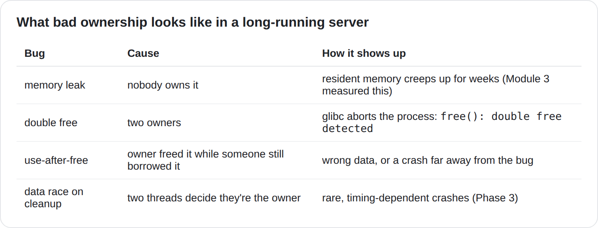

Smart pointers help, but they don't make the decision for me. Before I allocate anything, I now try to answer three questions:

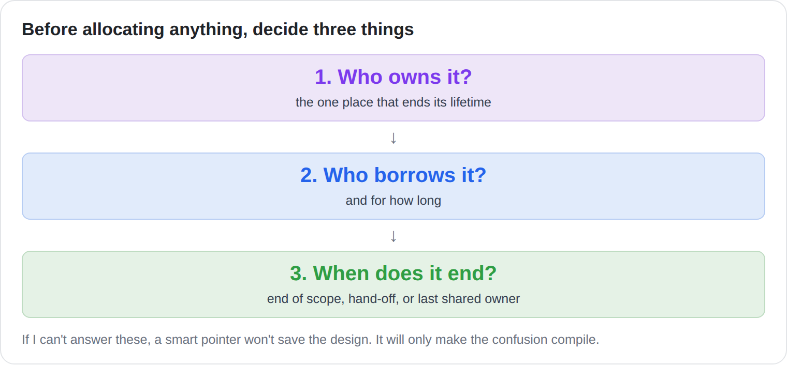

If I can't answer them, wrapping the pointer in a smart pointer only makes the confusion compile.

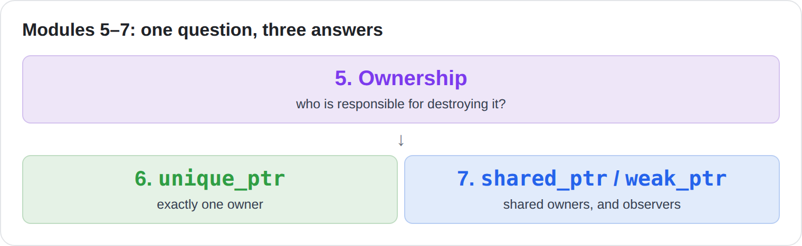

Next, [Module 6](../06-unique-ptr/) puts exclusive ownership into the type with `std::unique_ptr`.
