# Module 6: `std::unique_ptr` and exclusive ownership

[Module 5](../05-ownership-resource-management/) ended with ownership living in a convention: `processFile()` owns the buffer because I said so. This module moves that decision into the type. Module 4 used `unique_ptr` as one example of RAII; here I go through how it behaves when it's passed around, moved, borrowed and given a custom deleter.

All the code is in [`examples/`](examples/). `./run.sh` runs every example, rebuilds `move_ownership.cpp` with `-DSHOW_ERRORS` to show the copy error, and runs the leak and double-free cases under AddressSanitizer. The output is from GCC 11 on x86-64 Linux.

| File | What it shows | Run it |
|---|---|---|
| [`raw_vs_unique.cpp`](examples/raw_vs_unique.cpp) | An exception between allocation and cleanup: raw pointer vs `unique_ptr` | [Compiler Explorer](https://godbolt.org/z/hrW4fMn5G) |
| [`move_ownership.cpp`](examples/move_ownership.cpp) | Moving ownership, the copy error, and a function that takes ownership | [Compiler Explorer](https://godbolt.org/z/s85vTz47c) |
| [`passing.cpp`](examples/passing.cpp) | Three ways to pass it, and `.get()` borrowing | [Compiler Explorer](https://godbolt.org/z/cr4M8Td51) |
| [`custom_deleter.cpp`](examples/custom_deleter.cpp) | Owning a `FILE*`, deleter sizes, `release()` and `reset()` | [Compiler Explorer](https://godbolt.org/z/38q8hYYqc) |

---

## 6.1 The problem with raw pointers

This works as long as nothing goes wrong:

```cpp
void processFileRaw() {
    int* buffer = new int[1000];
    // process the file
    delete[] buffer;
}
```

Then the disk fails:

```cpp
void processFileRaw() {
    int* buffer = new int[1000];
    throw std::runtime_error("Disk error");
    delete[] buffer;                        // never reached
}
```

I could wrap every function in `try`/`catch` and free the buffer in the handler, but then every function grows a second copy of its cleanup. `raw_vs_unique.cpp` has both versions, and `main` catches the exception from each:

```cpp
void processFileUnique() {
    auto buffer = std::make_unique<int[]>(1000);
    buffer[0] = 42;
    throw std::runtime_error("Disk error");
}
```

Under AddressSanitizer:

```text
raw version: Disk error
unique_ptr version: Disk error
Direct leak of 4000 byte(s) in 1 object(s) allocated from:
    #1 processFileRaw() raw_vs_unique.cpp:6
SUMMARY: AddressSanitizer: 4000 byte(s) leaked in 1 allocation(s).
```

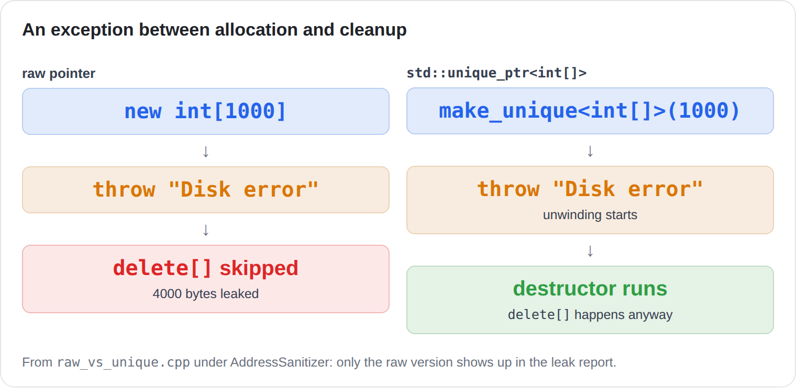

Both functions threw the same exception. Only the raw one leaked.

## 6.2 What is `unique_ptr`?

The picture I use is the key to a storage locker. Only one person holds the key, and when that person leaves, the locker is emptied and released.

`std::unique_ptr` is a **smart pointer**: an ordinary class object that holds a pointer and manages what it points to. A `unique_ptr` has exclusive ownership, so there's exactly one of it for each object it manages.

```cpp
std::unique_ptr<int> value = std::make_unique<int>(100);
std::cout << *value << '\n';    // 100
```

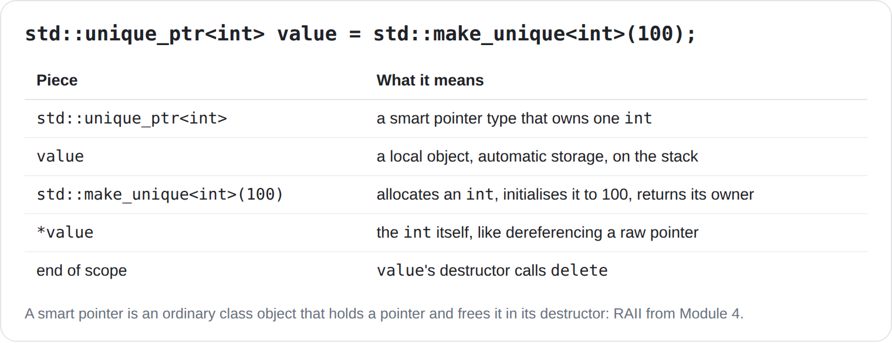

When `value` goes out of scope, its destructor deletes the `int`. There's no `delete` anywhere in my code.

## 6.3 How does the cleanup happen?

```cpp
void processFile() {
    auto buffer = std::make_unique<int[]>(1000);
    buffer[0] = 42;
    std::cout << buffer[0] << '\n';
}
```

![The six steps from make_unique to delete[]](images/03-cleanup-steps.png)

This is Module 4's RAII again. Because the type is `int[]`, the destructor uses `delete[]`, so the `new[]`/`delete` mismatch from Module 3 can't happen.

The thing to notice is that there are two objects here, with two different storage durations:

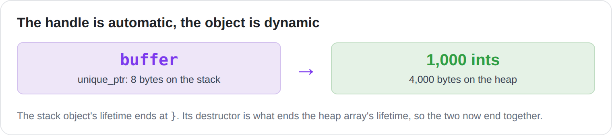

## 6.4 Why can't I copy one?

```cpp
auto first = std::make_unique<int>(100);
auto second = first;
```

If this compiled, there would be two "exclusive" owners of one `int`, and both destructors would delete it. That's a double free. So `unique_ptr`'s copy constructor is deleted, and the compiler refuses:

```text
move_ownership.cpp:30:17: error: use of deleted function ‘std::unique_ptr<_Tp, _Dp>::unique_ptr(const std::unique_ptr<_Tp, _Dp>&) [with _Tp = int; _Dp = std::default_delete<int>]’
```

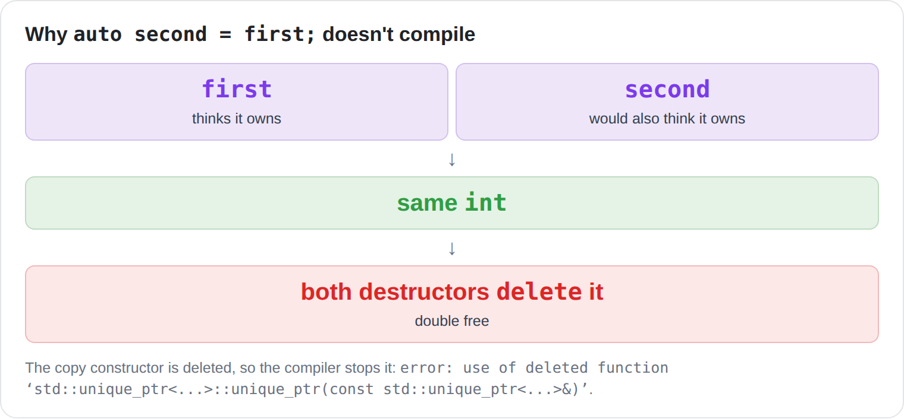

## 6.5 Transferring ownership with `std::move`

Instead of copying, I move:

```cpp
auto first = std::make_unique<int>(100);
int* originalAddress = first.get();
auto second = std::move(first);
```

`move_ownership.cpp` checks what happened:

```text
value: 100
first is nullptr: yes
same object: yes
```

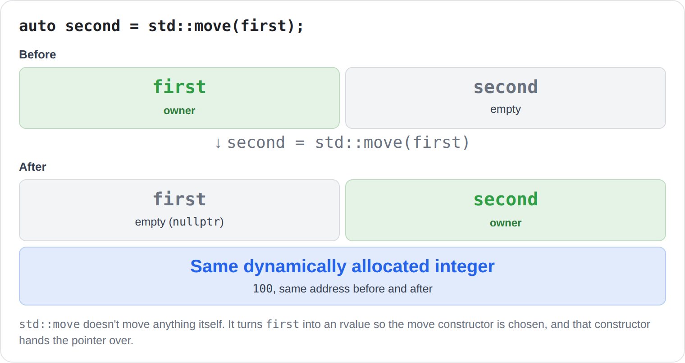

`second` now owns the `int`, `first` is empty, and the `int` itself wasn't copied or recreated: `second.get()` is the address `first` had. `std::move` doesn't move anything by itself. It casts `first` to an rvalue (Phase 1 Module 5), so the move constructor is chosen, and that's what hands the pointer over.

The same thing works across a function call. A function that takes `unique_ptr` by value takes ownership:

```cpp
void writeToDisk(std::unique_ptr<Buffer> buffer) {
    std::cout << "writeToDisk owns Buffer " << buffer->id << '\n';
}

auto buffer = std::make_unique<Buffer>(1);
writeToDisk(std::move(buffer));
```

`Buffer` prints when it's created and destroyed:

```text
+ Buffer 1
writeToDisk owns Buffer 1
- Buffer 1
back in main, buffer is empty: yes
```

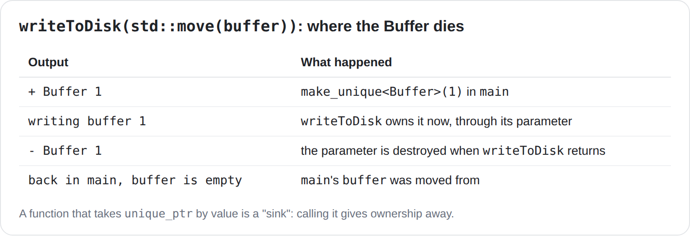

The `Buffer` is destroyed when `writeToDisk`'s parameter goes out of scope, before `main` gets to its next line. The `std::move` at the call site is the only clue that ownership leaves `main`, and it's required: without it, the call would try to copy and wouldn't compile.

## 6.6 Passing it without giving it away

Most functions don't need ownership at all. A checksum function only reads the data, so it shouldn't become the owner. `passing.cpp` tries the three common signatures:

```cpp
using Buffer = std::unique_ptr<char[]>;

void storageWorker(Buffer buffer);                          // takes ownership
void logOwner(const std::unique_ptr<char[]>& buffer);      // looks at the handle
int calculateChecksum(std::span<const char> buffer);       // just reads the bytes
```

```text
storageWorker owns buffer: yes
after storageWorker, handler is empty
logOwner sees buffer: not empty
after logOwner, handler still owns buffer: yes
checksum: 65
after checksum, handler still owns buffer: yes
```

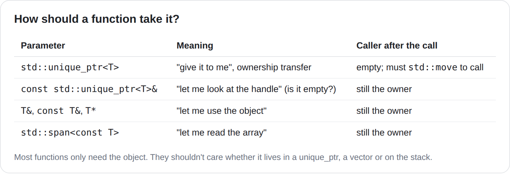

The rule I settled on:

- Pass `unique_ptr` by value when ownership is being transferred.
- Pass `const unique_ptr&` only when the function needs the handle itself, for example to check whether it's empty.
- Otherwise, pass a reference, a raw pointer or a view like `std::span` to the object. The function then works the same whether the data lives in a `unique_ptr`, a `vector` or on the stack.

Raw pointers are still fine for borrowing. `.get()` returns one without giving up ownership:

```cpp
auto buffer = std::make_unique<int[]>(1000);

int* checksumBuffer = buffer.get();
int* writerBuffer = buffer.get();
```

This is the same three-pointer picture from Module 5, but now the answer is in the types. `buffer` owns the array. `checksumBuffer` and `writerBuffer` only borrow it, so neither of them may call `delete[]`. With `-DSHOW_BUG`, `checksumBuffer` does it anyway:

```text
ERROR: AddressSanitizer: attempting double-free on thread T0:
    #3 main passing.cpp:51
freed by thread T0 here:
    #1 main passing.cpp:49
previously allocated by thread T0 here:
    #2 main passing.cpp:42
SUMMARY: AddressSanitizer: double-free ..asan_new_delete.cpp:163 in operator delete[](void*)
```

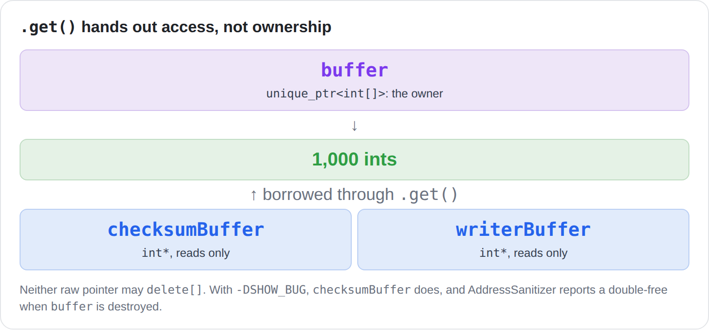

Line 49 is my `delete[] checksumBuffer`. Line 51 is the closing `}` of `main`, where `buffer`'s destructor frees the same array a second time.

## 6.7 Owning things that aren't `new`ed: custom deleters

`unique_ptr` calls `delete` by default, but the second template parameter lets it call anything. That's how I'd own a `FILE*` from `fopen` or `tmpfile`, which must be closed with `fclose`:

```cpp
struct StructDeleter {
    void operator()(FILE* file) const {
        if (file != nullptr) {
            std::fclose(file);
        }
    }
};

std::unique_ptr<FILE, StructDeleter> file(std::tmpfile());
// fclose runs automatically when file goes out of scope
```

A plain function works too, as `std::unique_ptr<FILE, int (*)(FILE*)>`. The difference shows up in the size:

```text
sizeof(int*) = 8
sizeof(unique_ptr<int>) = 8
sizeof(unique_ptr<FILE, StructDeleter>) = 8
sizeof(unique_ptr<FILE, int(*)(FILE*)>) = 16
```

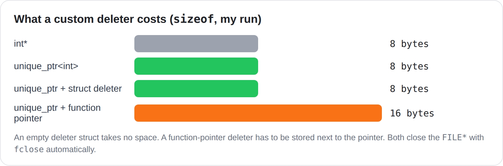

An empty struct deleter takes no space, so the `unique_ptr` stays the size of a raw pointer. A function-pointer deleter has to be stored in every `unique_ptr`, so it doubles the size. For a buffer pool or millions of handles, I'd use the struct.

The same example also uses `release()` and `reset()`, which are easy to mix up:

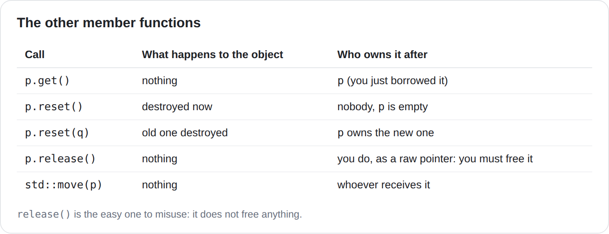

`release()` doesn't free anything. It hands back the raw pointer, and from then on I'm the owner again, so in the example I have to call `fclose` myself. `reset()` closes the file right away.

## 6.8 `unique_ptr` in the storage server

Putting it together: a request handler creates a buffer and hands it to a storage worker.

```cpp
using Buffer = std::unique_ptr<char[]>;

void storageWorker(Buffer buffer) {
    // the worker owns the buffer now; write it to storage
}

void requestHandler() {
    Buffer buffer = std::make_unique<char[]>(4096);
    storageWorker(std::move(buffer));
}
```

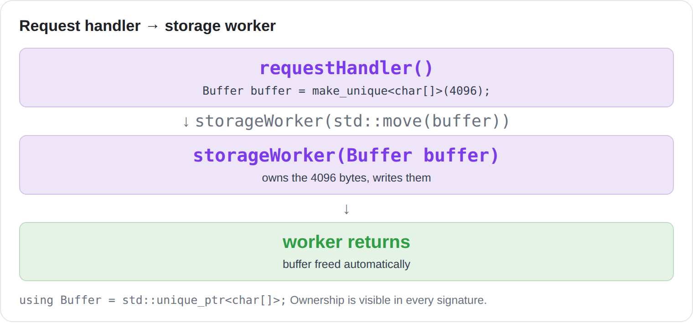

Every signature says who owns the buffer. The handler creates it, `std::move` hands it over, and it's freed when the worker returns. There's no `delete` to forget, and no path where it's freed twice.

Next, [Module 7](../07-shared-ptr-weak-ptr/) covers the case where there's no single owner.
