# Module 7: `std::shared_ptr` and `std::weak_ptr`

[Module 6](../06-unique-ptr/) assumed every object has one owner. Sometimes that isn't true: several components need an object to stay alive, and none of them knows when the others are done. This module is about shared ownership, what it costs, the leak it can cause, and how `weak_ptr` fixes that leak.

All the code is in [`examples/`](examples/). `./run.sh` runs every example, runs the reference cycle under AddressSanitizer, and rebuilds it with `-DWEAK` to show the fix. The output is from GCC 11 on x86-64 Linux.

| File | What it shows | Run it |
|---|---|---|
| [`connection.cpp`](examples/connection.cpp) | One connection, three owners, destroyed when the last one lets go | [Compiler Explorer](https://godbolt.org/z/T51639sPE) |
| [`use_count.cpp`](examples/use_count.cpp) | The reference count going up and down | [Compiler Explorer](https://godbolt.org/z/85dxYnjTb) |
| [`sizes_allocs.cpp`](examples/sizes_allocs.cpp) | `sizeof` each smart pointer, and heap allocations for `make_shared` | [Compiler Explorer](https://godbolt.org/z/P1Mn8f4rd) |
| [`cycle.cpp`](examples/cycle.cpp) | A reference cycle that leaks, and the `weak_ptr` fix | [Compiler Explorer](https://godbolt.org/z/d4W1zvK8K) |
| [`weak_lock.cpp`](examples/weak_lock.cpp) | `weak_ptr::lock()` while the object is alive and after it's gone | [Compiler Explorer](https://godbolt.org/z/Y7nhqx8Ke) |

---

## 7.1 The problem: several components need the object alive

My storage server has a connection object, and three components use it: the request handler, a monitoring service and a background health checker.


Say the request handler finishes while the health checker is still using the connection. The connection shouldn't be destroyed just because the handler is done. It has to stay alive as long as any of them still needs it, and with `unique_ptr` I'd have to pick one of them as the owner. None of them is the right choice.

## 7.2 What is `shared_ptr`?

A `std::shared_ptr` lets several owners share responsibility for one object. It keeps a **reference count**: the number of `shared_ptr`s that currently own the object. Copying a `shared_ptr` adds an owner. Destroying or resetting one removes an owner. When the count reaches zero, the object is destroyed.

`connection.cpp` gives the connection three owners and releases them one at a time:

```cpp
auto requestHandler = std::make_shared<Connection>();
auto monitoring = requestHandler;
auto healthChecker = monitoring;

requestHandler.reset();
monitoring.reset();
healthChecker.reset();
```

```text
connection created (owners: 3)
connection still alive (owners: 2)
connection still alive (owners: 1)
- Connection
```

The destructor ran exactly once, after the last owner let go.

## 7.3 How reference counting works

```cpp
auto first = std::make_shared<Tracked>();
auto second = first;
auto third = second;
```

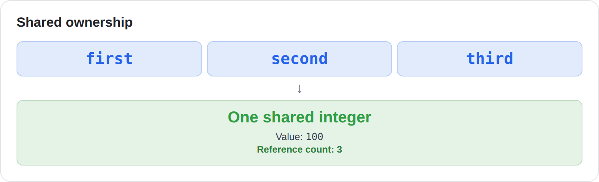

`use_count.cpp` prints the count after every step, and `Tracked` prints when it's created and destroyed:

```text
+ Tracked
after make_shared: 1
after second = first: 2
after third = second: 3
inside function: use_count = 4
after function returns: 3
after first.reset: 2
after second.reset: 1
- Tracked
after third.reset: 0
```

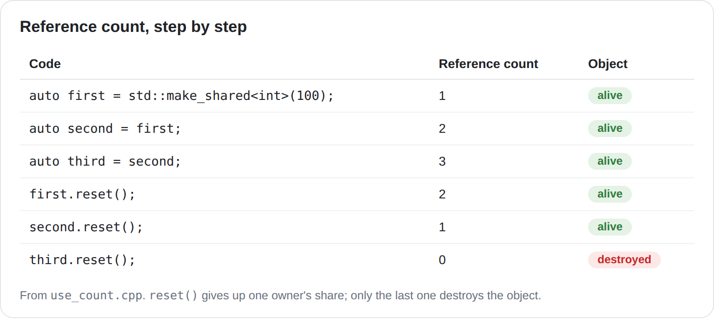

Two things stand out. Passing a `shared_ptr` by value to a function adds an owner for as long as the call lasts (the 4), so a function that only reads the object should take a reference to it instead. And `reset()` only gives up that one `shared_ptr`'s share. `first.reset()` didn't destroy anything; only the last `reset()` did.

## 7.4 What's inside a `shared_ptr`

The count has to live somewhere that every copy can see, so it isn't stored in the `shared_ptr` itself. It's in a separate **control block**, and each `shared_ptr` holds two pointers: one to the object and one to the control block.

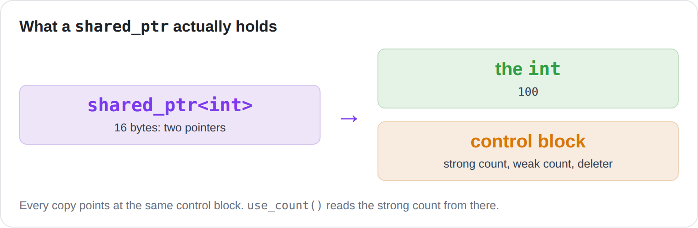

`sizes_allocs.cpp` measures this. It also replaces the global `operator new` with one that counts calls, so I could see how many heap allocations each way of creating an owner takes:

```text
sizeof(unique_ptr<int>) = 8
sizeof(shared_ptr<int>) = 16
sizeof(weak_ptr<int>) = 16
shared_ptr(new int): 2 allocation(s)
make_shared<int>: 1 allocation(s)
make_unique<int>: 1 allocation(s)
```

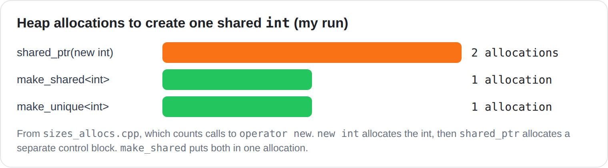

`std::shared_ptr<int>(new int(100))` allocates the `int`, then the `shared_ptr` constructor allocates a control block for it. `std::make_shared` puts the object and the control block in one allocation. That's the main reason I use `make_shared` instead of `new`.

## 7.5 `shared_ptr` vs `unique_ptr`

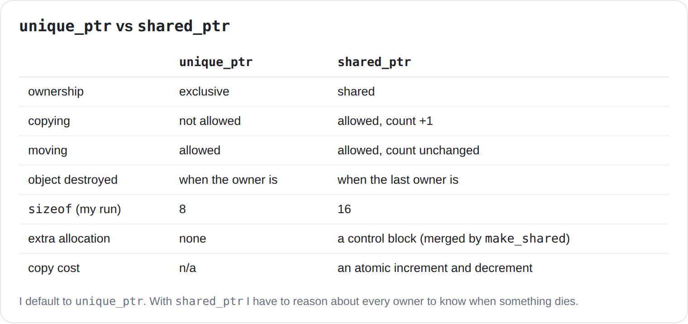

The row I care about most isn't the size. With `unique_ptr` I can point at the one line where an object dies. With `shared_ptr` I have to find every owner and work out when each of them lets go. So I use `unique_ptr` by default, and `shared_ptr` only when the lifetime really is shared, like the connection above.

## 7.6 Reference cycles

Here's the bug that shared ownership adds. A `StorageNode` holds a `shared_ptr` to its `MonitoringService`, and the monitoring service holds a `shared_ptr` back to the node:

```cpp
struct StorageNode {
    std::shared_ptr<MonitoringService> monitoring;
    ~StorageNode() { std::cout << "- StorageNode\n"; }
};

struct MonitoringService {
    std::shared_ptr<StorageNode> node;
    ~MonitoringService() { std::cout << "- MonitoringService\n"; }
};

{
    auto node = std::make_shared<StorageNode>();
    auto monitoring = std::make_shared<MonitoringService>();
    node->monitoring = monitoring;
    monitoring->node = node;
}
std::cout << "block ended\n";
```

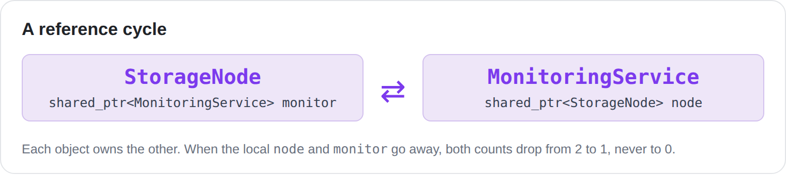

```text
node use_count: 2
monitor use_count: 2
block ended
```

Neither destructor ran. Each object has two owners inside the block: the local variable and the other object. When the block ends, the two locals go away and each count drops to 1, held by the other object. Nothing else can reach either of them, and neither count will ever reach zero. This is called a **reference cycle**, and it's a leak.

AddressSanitizer agrees:

```text
Indirect leak of 32 byte(s) in 1 object(s) allocated from:
Indirect leak of 32 byte(s) in 1 object(s) allocated from:
SUMMARY: AddressSanitizer: 64 byte(s) leaked in 2 allocation(s).
```

Each 32-byte block is one `make_shared` allocation: the control block plus the object. LeakSanitizer calls a block an *indirect* leak when the only pointers to it come from other leaked blocks. In a cycle that's true of both blocks, so there's no "direct" leak line at all, which is worth knowing when you're scanning a report for one.

## 7.7 Breaking the cycle with `weak_ptr`

A `std::weak_ptr` is a non-owning reference to an object that's managed by `shared_ptr`. It points at the same control block, but it doesn't add to the owner count.

The fix is to decide which direction ownership really goes. The node owns its monitor; the monitor only needs to observe the node:

```cpp
struct MonitoringService {
    std::weak_ptr<StorageNode> node;    // observes, doesn't own
};
```

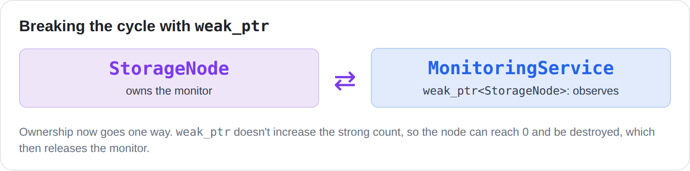

`cycle.cpp` built with `-DWEAK`:

```text
node use_count: 1
monitor use_count: 2
- StorageNode
- MonitoringService
block ended
```

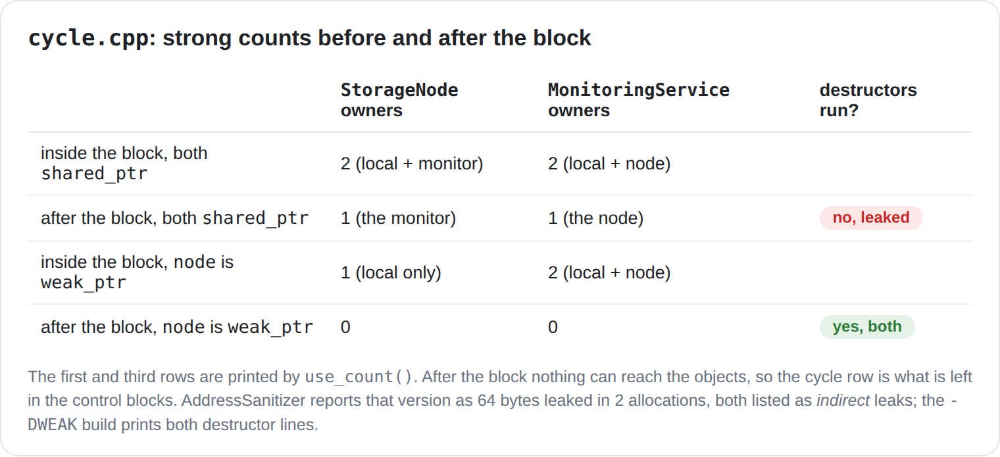

Now the node has only one owner, the local variable. At the end of the block its count reaches zero and it's destroyed. Destroying it destroys its `monitoring` member, which was the monitor's last owner, so the monitor goes too.

## 7.8 Using a `weak_ptr`

A `weak_ptr` doesn't guarantee the object still exists, so it can't be dereferenced directly. I have to ask for a temporary owner with `lock()`:

```cpp
std::weak_ptr<int> observer = owner;

if (auto strong = observer.lock()) {
    // alive: strong owns it until the end of this block
} else {
    // already destroyed
}
```

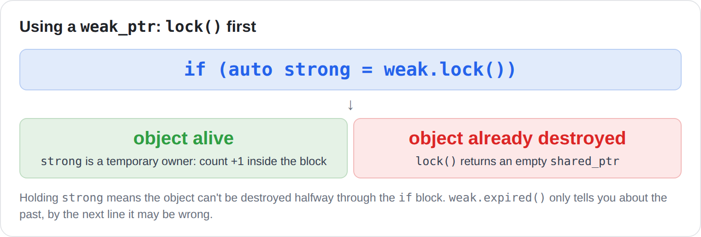

`lock()` returns a `shared_ptr`. If the object is alive, it's a real owner; if not, it's empty, and the `if` condition is false. `weak_lock.cpp` tries it both ways:

```text
use_count before weak_ptr: 1
use_count after weak_ptr: 1
resource is alive; use_count: 2
use_count after lock scope: 1
expired: yes
already destroyed
```

Creating the `weak_ptr` didn't change the count. Inside the `if`, `strong` was a second owner, which is the point: the object can't be destroyed halfway through the block, even if another part of the program resets its own owner meanwhile. There's also `expired()`, but its answer can be out of date by the next line, so `lock()` is the safer check.

## 7.9 The three together

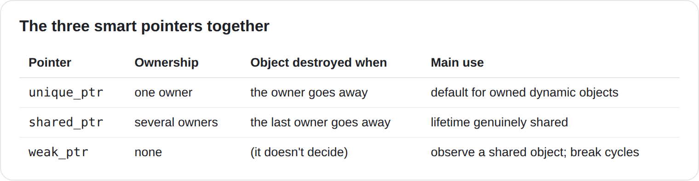

When I'm deciding how to hold something, I go down this list and stop at the first one that fits:

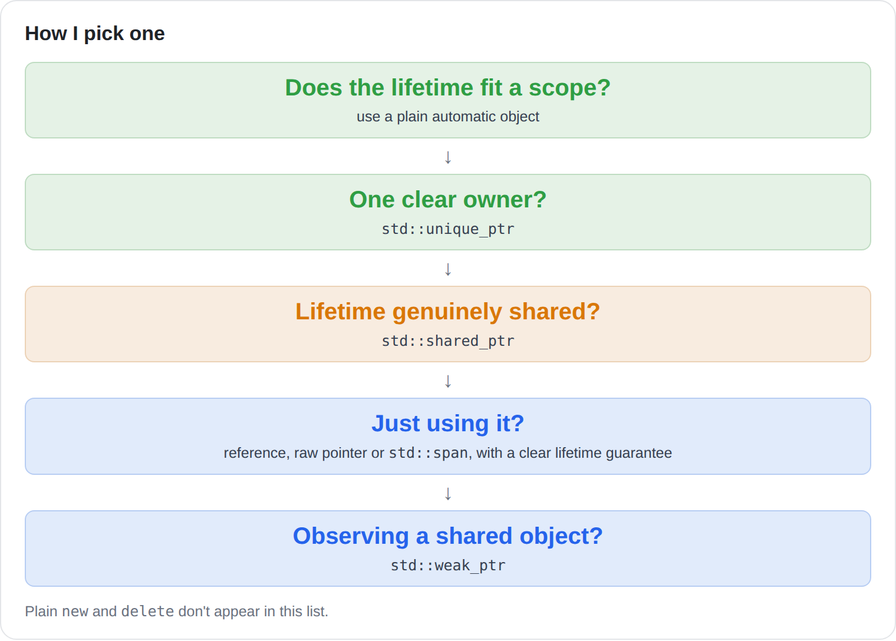

One more thing to be careful about: `shared_ptr` is often described as thread-safe, but that only applies to the reference count.

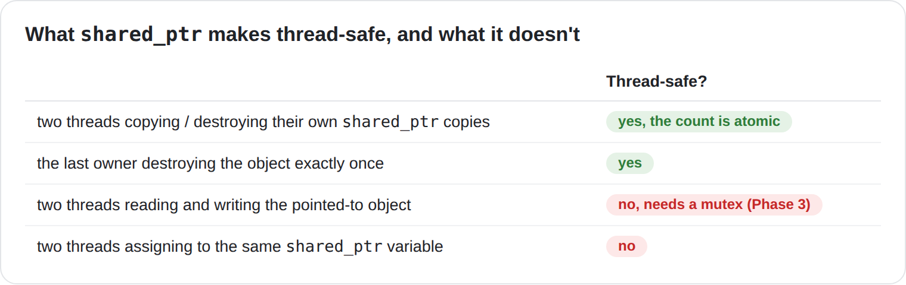

Two threads can each copy and destroy their own `shared_ptr` to the same object, and the object is still destroyed exactly once. But if both threads read and write the object itself, they still need a mutex. I'll come back to this in Phase 3.
