# Module 8: Copy semantics

Modules 5–7 were about who owns an object. This module asks a smaller question that turns out to be the same one: what happens when I copy an object that owns something? For an `int` member, nothing interesting. For a pointer member, the copy can end with two objects deleting the same array.

All the code is in [`examples/`](examples/). `./run.sh` builds every example, shows the compiler error for a by-value copy constructor, and runs the shallow copy both normally and under AddressSanitizer. The output is from GCC 11 on x86-64 Linux.

| File | What it shows | Run it |
|---|---|---|
| [`copy_basics.cpp`](examples/copy_basics.cpp) | Value copying, and which statements call the copy constructor vs copy assignment | [Compiler Explorer](https://godbolt.org/z/Mbffjoz73) |
| [`shallow_copy.cpp`](examples/shallow_copy.cpp) | The generated copy of a raw-pointer class, ending in a double free | [Compiler Explorer](https://godbolt.org/z/fbKWPGWqW) |
| [`deep_copy.cpp`](examples/deep_copy.cpp) | A Rule of Three class with a deep copy constructor and copy assignment | [Compiler Explorer](https://godbolt.org/z/a73MMfE7W) |

---

## 8.1 The problem: what does copying an object mean?

My storage server has a class for a file buffer. In its simplest form it only stores a size:

```cpp
struct PlainBuffer {
    int size;
};

PlainBuffer first{1000};
PlainBuffer second = first;
second.size = 2000;
```

`second` is a new object, and its `size` is copied from `first`. Changing one afterwards doesn't affect the other:

```text
first.size = 1000
second.size = 2000
```

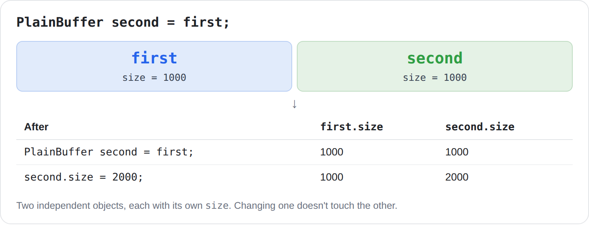

That's ordinary value copying, the same as copying an `int`. The rest of this module is about when it stops being that simple.

## 8.2 What is a copy constructor?

A copy constructor is the constructor that builds a new object from an existing object of the same class. I can write my own to see when it runs:

```cpp
class FileBuffer {
public:
    int size;

    explicit FileBuffer(int value) : size(value) {}

    FileBuffer(const FileBuffer& other) : size(other.size) {
        std::cout << "copy constructor\n";
    }
};
```

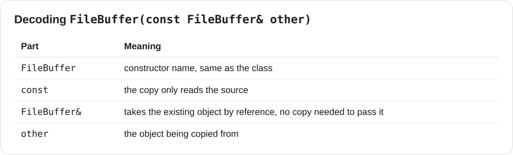

The `const` is there because copying should only read the source. The `&` matters more. If the parameter were a plain `FileBuffer`, passing the source in would itself be a copy, which needs the copy constructor, which needs another copy:

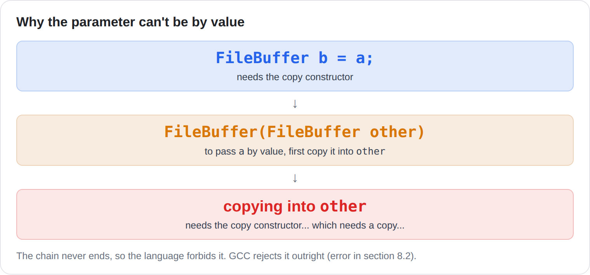

The language doesn't allow that, and GCC even suggests the fix (`copy_basics.cpp` with `-DSHOW_ERRORS`):

```text
copy_basics.cpp:31:5: error: invalid constructor; you probably meant ‘BadBuffer (const BadBuffer&)’
```

## 8.3 When does it run?

`copy_basics.cpp` prints a label before each statement, so I can see which special function each one calls. I also gave `FileBuffer` a copy-assignment operator that prints `copy assignment` (section 8.6 explains it):

```text
--- FileBuffer a(1000);
--- FileBuffer b = a;
copy constructor
--- FileBuffer c(a);
copy constructor
--- FileBuffer d(500); d = a;
copy assignment
--- inspect(a);
copy constructor
inspect received buffer of size 1000
```

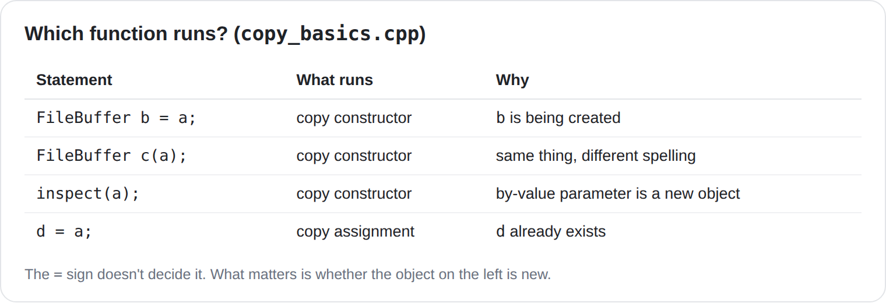

`FileBuffer b = a;` looks like an assignment, but `b` is being created, so it's a copy construction. Passing `a` to `void inspect(FileBuffer buffer)` is one too, because the parameter is a new object.

## 8.4 If I don't write one

If I don't declare a copy constructor, the compiler generates one that copies each member in turn. This is called **memberwise copying**:

```cpp
class FileBuffer {
public:
    int size;
    double checksum;
};

FileBuffer first{1000, 12.5};
FileBuffer second = first;   // copies size, then checksum
```

For values like `int` and `double` that's exactly right. A pointer member is also copied as a value, and its value is an address:

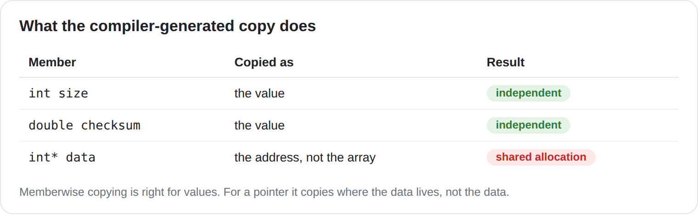

## 8.5 The shallow-copy problem

Here's a version that owns a heap array, with a destructor and nothing else:

```cpp
class FileBuffer {
public:
    int* data;

    explicit FileBuffer(int size) : data(new int[size]) {}

    ~FileBuffer() {
        delete[] data;
    }
};

FileBuffer first(1000);
FileBuffer second = first;
```

The generated copy constructor copies `data`, so both objects point at the same array. `shallow_copy.cpp` prints both pointers:

```text
first.data  = 0x63b0ebebfeb0
second.data = 0x63b0ebebfeb0
same allocation: yes
double free or corruption (!prev)
exit status: 134
```

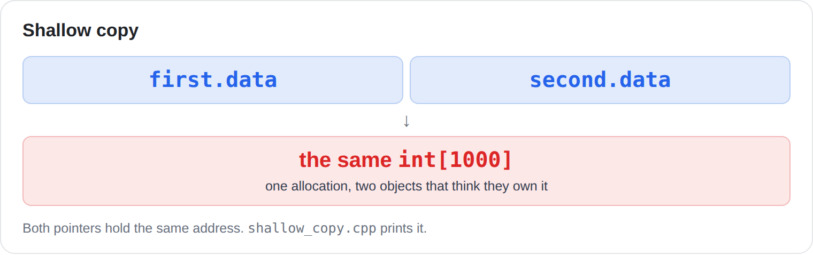

The last two lines happen when `main` returns. Objects are destroyed in reverse order, so `second` frees the array and then `first` frees it again:

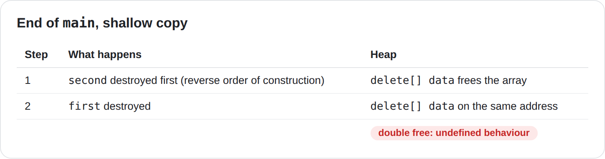

Here glibc happened to notice and abort (status 134 is `SIGABRT`). A double free is undefined behaviour, so I can't count on that. AddressSanitizer reports it every time, with both destructor calls and the original allocation:

```text
ERROR: AddressSanitizer: attempting double-free on thread T0:
    #0 operator delete[](void*)
    #1 FileBuffer::~FileBuffer() shallow_copy.cpp:10
    #2 main shallow_copy.cpp:21
freed by thread T0 here:
    #0 operator delete[](void*)
    #1 FileBuffer::~FileBuffer() shallow_copy.cpp:10
    #2 main shallow_copy.cpp:21
previously allocated by thread T0 here:
    #1 FileBuffer::FileBuffer(int) shallow_copy.cpp:7
    #2 main shallow_copy.cpp:15
SUMMARY: AddressSanitizer: double-free in operator delete[](void*)
```

GCC compiled `shallow_copy.cpp` with `-Wall -Wextra` and gave no warning. This is the same "everyone deletes" bug from [Module 5](../05-ownership-resource-management/), except here the compiler wrote the second owner for me.

## 8.6 Shallow copy vs deep copy

A **deep copy** allocates new memory and copies the contents into it, so each object owns its own array:

```cpp
FileBuffer(const FileBuffer& other) : data(new int[other.size]), size(other.size) {
    std::copy(other.data, other.data + size, data);
}
```

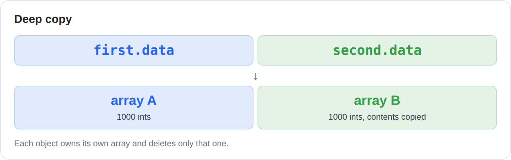

`deep_copy.cpp` checks that the arrays are separate by changing one of them:

```text
first.data  = 0x6416bfd68eb0
second.data = 0x6416bfd69e60
same allocation: no
first.data[0] = 42
second.data[0] = 7
```

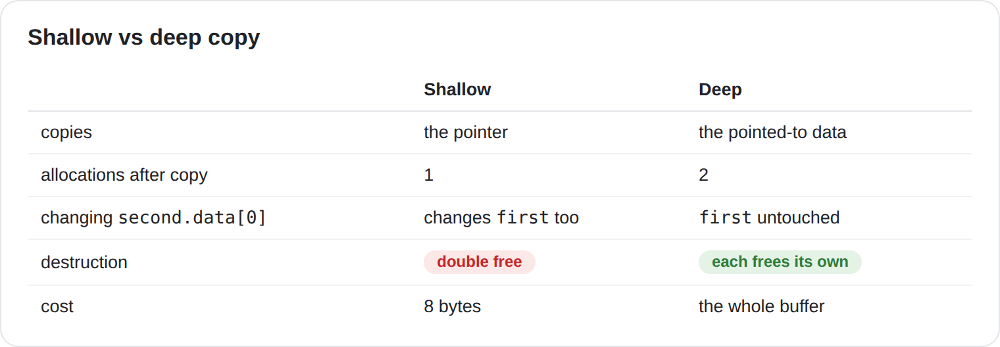

## 8.7 Copy construction vs copy assignment

There are two ways to copy into an object, and they need different code:

```cpp
FileBuffer second = first;   // copy construction: second is new
FileBuffer third(10);
third = first;               // copy assignment: third already owns an array
```

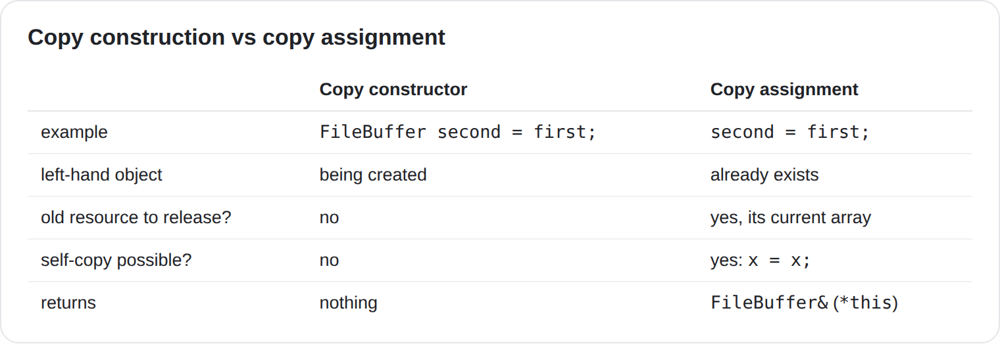

The assignment case has two extra problems. `third` already owns 10 ints, which have to be freed or they leak. And `third = third;` has to work too, so I can't free my own array before reading from the source. This is the copy assignment in `deep_copy.cpp`:

```cpp
FileBuffer& operator=(const FileBuffer& other) {
    if (this != &other) {
        int* newData = new int[other.size];
        std::copy(other.data, other.data + other.size, newData);
        delete[] data;
        data = newData;
        size = other.size;
    }
    return *this;
}
```

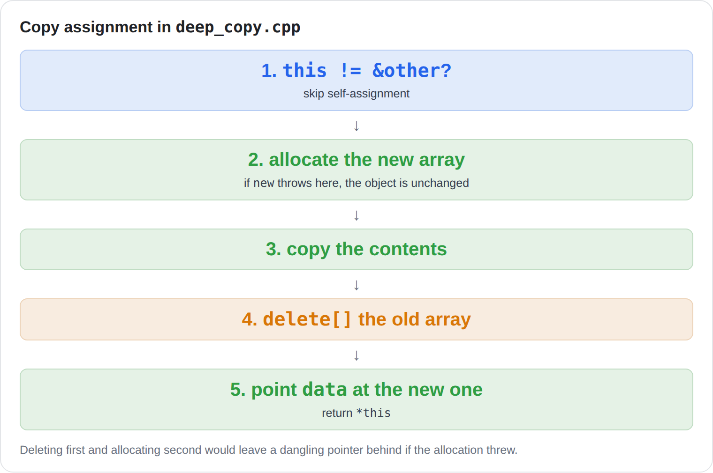

I allocate the new array before deleting the old one. If `new` throws, `data` still points at the old, valid array instead of at freed memory. `deep_copy.cpp` checks both cases and runs clean under AddressSanitizer:

```text
third.size = 1000
third.data[0] = 42
AddressSanitizer: no errors
```

## 8.8 The Rule of Three

The destructor, the copy constructor and the copy-assignment operator all decide something about the same resource: how to release it, how to duplicate it, and how to replace it. If a class needs a hand-written version of one of them, it nearly always needs all three. That's the **Rule of Three**.

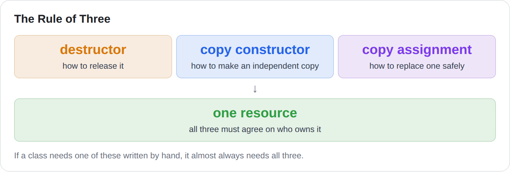

`shallow_copy.cpp` breaks it: it has a destructor and nothing else. `deep_copy.cpp` follows it.

Copying a large buffer is correct, but it isn't free. A deep copy of a 2 GB buffer allocates and writes another 2 GB. [Module 9](../09-move-semantics/) covers the case where the source doesn't need its buffer any more and I can hand it over instead.
