# Module 9: Move semantics

[Module 8](../08-copy-semantics/) ended with a deep copy: correct, but it duplicates the whole buffer. Often the source is about to be destroyed anyway, and the copy is wasted. Move semantics lets an object hand its resource to another object instead.

All the code is in [`examples/`](examples/). `./run.sh` builds every example, shows two reference-binding errors, and runs the Rule of Five buffer under AddressSanitizer. The output is from GCC 11 on x86-64 Linux.

| File | What it shows | Run it |
|---|---|---|
| [`rvalue_refs.cpp`](examples/rvalue_refs.cpp) | `&` vs `&&`, overload selection, and `std::move` not moving anything by itself | [Compiler Explorer](https://godbolt.org/z/M7cnd5rxb) |
| [`move_buffer.cpp`](examples/move_buffer.cpp) | A Rule of Five `FileBuffer` with move constructor and move assignment | [Compiler Explorer](https://godbolt.org/z/cbE3xcEMT) |
| [`copy_vs_move.cpp`](examples/copy_vs_move.cpp) | Timing a copy and a move of a 10,000,000-int vector (`-O2`) | [Compiler Explorer](https://godbolt.org/z/xordbY9fn) |
| [`noexcept_vector.cpp`](examples/noexcept_vector.cpp) | Why `noexcept` on a move constructor changes what `std::vector` does | [Compiler Explorer](https://godbolt.org/z/P41E1fjrz) |

---

## 9.1 The problem: copying a buffer nobody needs twice

Say my storage server has read a 2 GB file into a `FileBuffer`, and the next stage of the pipeline should take it over. With only copy semantics, the hand-off allocates another 2 GB, copies all of it, and then destroys the original.


What I want is to transfer ownership of the existing allocation. **Move semantics** means transferring a resource from one object to another, instead of copying the resource.

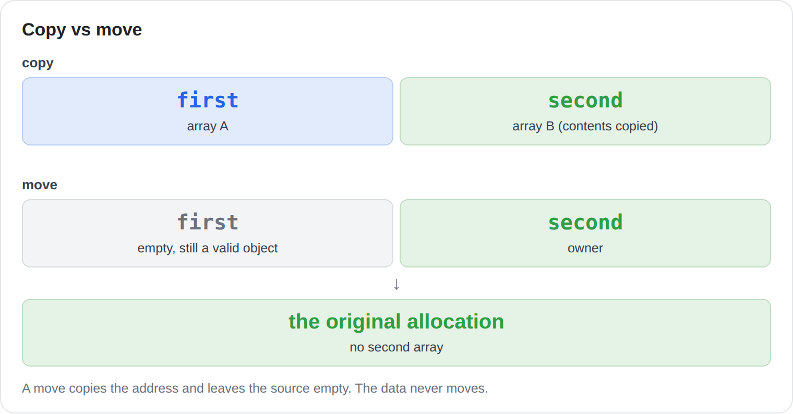

## 9.2 Rvalue references (`&&`)

To move, the compiler needs to know which objects are safe to take from. It uses the value categories from Phase 1. An ordinary reference `int&` binds to a named object (an lvalue). An **rvalue reference** `int&&` binds to temporaries, which are about to disappear anyway:

```cpp
int x = 10;
int& ref = x;       // lvalue reference to a named object
int&& rref = 10;    // rvalue reference to a temporary
```

Mixing them up doesn't compile (`rvalue_refs.cpp` with `-DSHOW_ERRORS`):

```text
rvalue_refs.cpp:30:16: error: cannot bind non-const lvalue reference of type ‘int&’ to an rvalue of type ‘int’
rvalue_refs.cpp:31:21: error: cannot bind rvalue reference of type ‘int&&’ to lvalue of type ‘int’
```

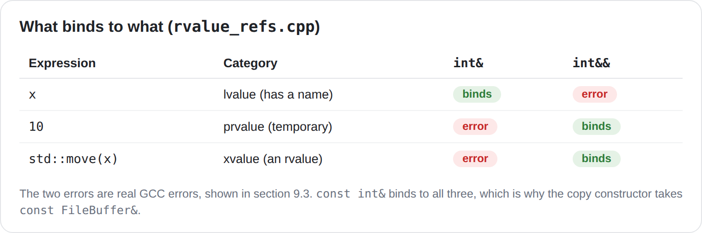

The useful part is overloading. With one function for each kind of reference, the compiler picks based on the argument:

```cpp
void take(const std::string&);   // prints "lvalue overload"
void take(std::string&&);        // prints "rvalue overload"

std::string name = "disk-07";
take(name);
take(std::string("temp"));
take(std::move(name));
```

```text
lvalue overload
rvalue overload
rvalue overload
name after std::move without a move: "disk-07"
```

## 9.3 `std::move` doesn't move

The last line of that output is the part to remember. `take(std::move(name))` chose the rvalue overload, but `name` still holds `"disk-07"`, because that overload never took anything from it. `std::move` is a cast to an rvalue reference. It lets a move happen; it doesn't do one.

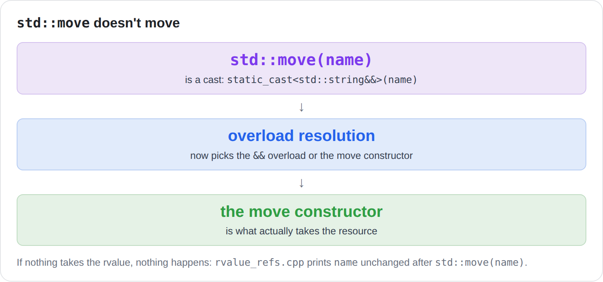

The move itself happens in a move constructor or move-assignment operator.

## 9.4 The move constructor

A move constructor builds a new object by taking the resource from an existing one. Its parameter is `FileBuffer&&`:

```cpp
FileBuffer(FileBuffer&& other) noexcept {
    data = other.data;
    size = other.size;
    other.data = nullptr;
    other.size = 0;
}
```

The first two lines copy an address and a number, not the array. The last two empty the source, so its destructor won't free the array the new object now owns. Without them, this is the shallow copy from Module 8, with the same double free.

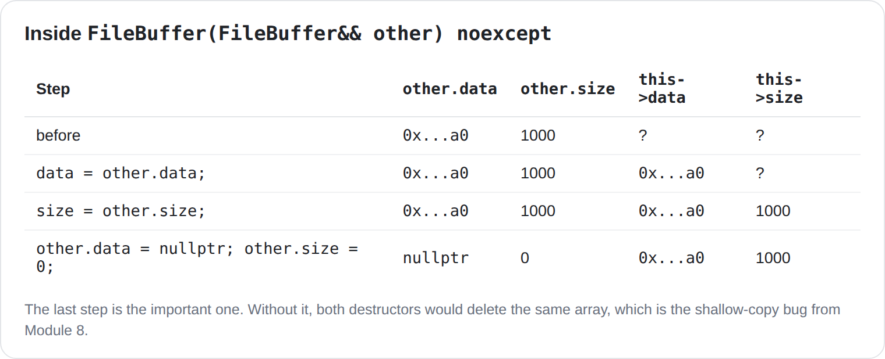

In `move_buffer.cpp` I wrote the same thing with `std::exchange`, which returns the old value and stores the new one in a single call:

```cpp
FileBuffer(FileBuffer&& other) noexcept
    : data(std::exchange(other.data, nullptr)), size(std::exchange(other.size, 0)) {}
```

`noexcept` promises the constructor won't throw. Section 9.8 shows why that promise matters.

## 9.5 Calling it

```cpp
FileBuffer first(1000);
int* original = first.data;
FileBuffer second = std::move(first);
```

```text
allocated 1000 ints
move constructor
second.data == original: yes
first.data: nullptr
first.size: 0
```

There was one allocation, and `second` ended up with the same address `first` had. `first` is still a valid object; it's just empty, and its destructor has nothing to free.

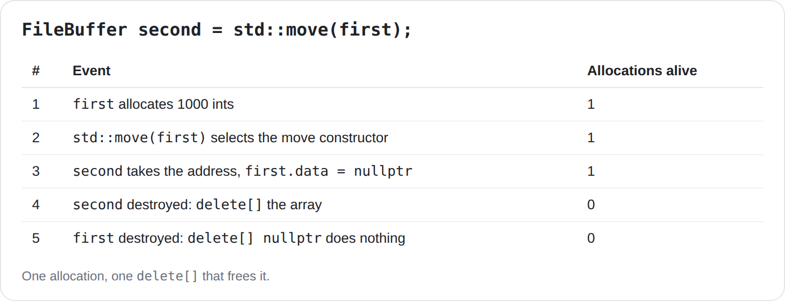

## 9.6 Move assignment

Move assignment is the same idea for an object that already exists, so like copy assignment it has to release what it owned before:

```cpp
FileBuffer& operator=(FileBuffer&& other) noexcept {
    if (this != &other) {
        delete[] data;
        data = std::exchange(other.data, nullptr);
        size = std::exchange(other.size, 0);
    }
    return *this;
}
```

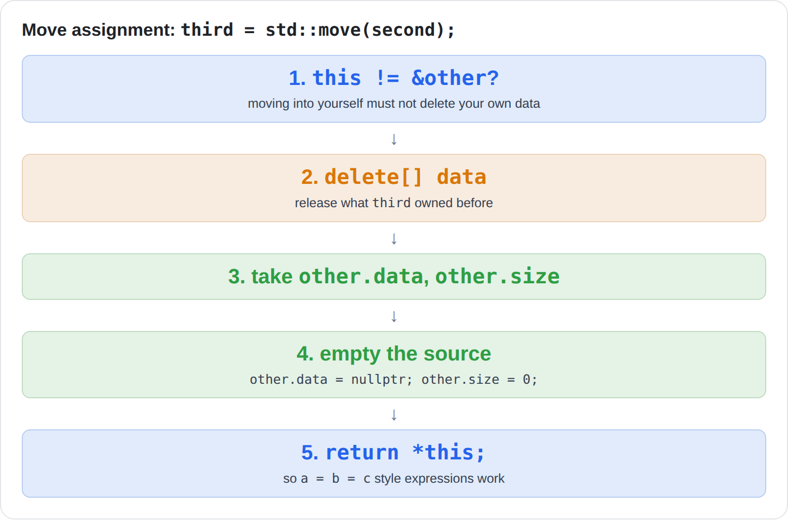

`move_buffer.cpp` moves the buffer on again into an object that already owned 10 ints, then copies it once to show the difference. The destructor prints whether it had anything to free:

```text
allocated 10 ints
move assignment
third.data == original: yes
second.data: nullptr
second.size: 0
copy constructor (allocated 1000 ints)
copy.size: 1000
~FileBuffer releasing 1000 ints
~FileBuffer releasing 1000 ints
~FileBuffer (empty)
~FileBuffer (empty)
```

Four objects, two arrays still alive at the end, and two empty moved-from objects. The 10-int array was freed inside the move assignment. AddressSanitizer reports no errors.

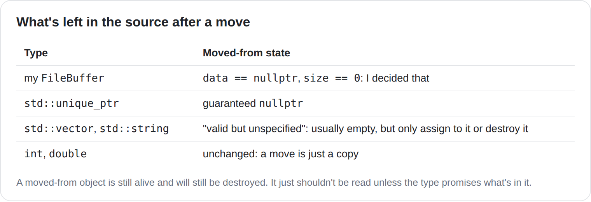

## 9.7 The Rule of Five

Adding the two move operations to Module 8's three gives five special member functions that all deal with the same resource:

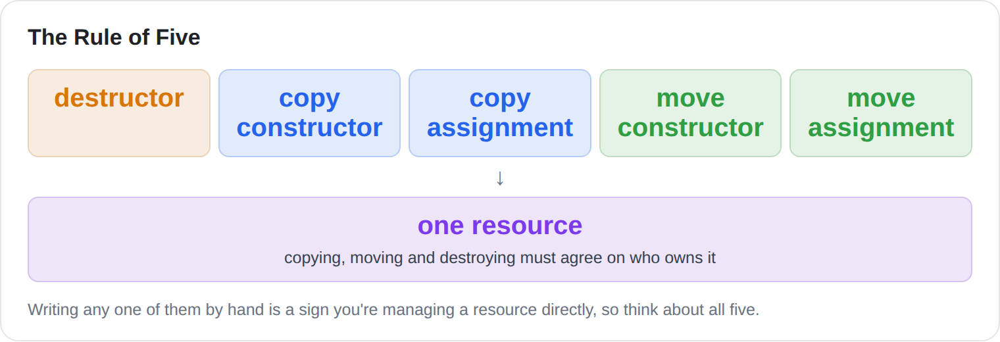

If a class manages a resource directly and I write any one of these, I have to think about all five, because copying, moving and destroying must agree on who owns the resource. `move_buffer.cpp` defines all five.

## 9.8 Does moving always make things faster?

No. `copy_vs_move.cpp` times both on a `std::vector<int>` with 10 million elements, built at `-O2`, median of five runs:

```text
copy: 22216 us
move: 0 us
moved.data() == before: yes
first.size() after move: 0
int move: source = 10, destination = 10
```

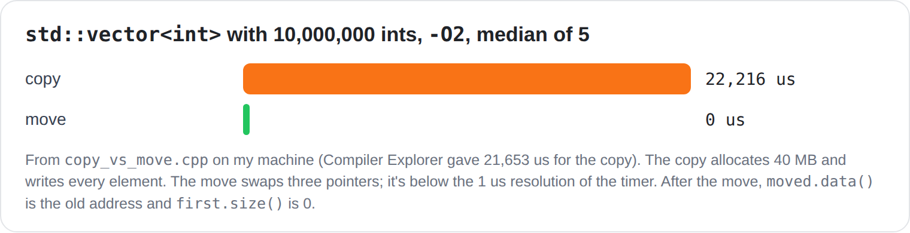

The copy allocated 40 MB and wrote every element. The move took less than the timer's 1 µs resolution, since it hands over three pointers. For the `int`, "moving" just copied the value, and the source still holds 10. Moving helps when the object owns something on the heap:

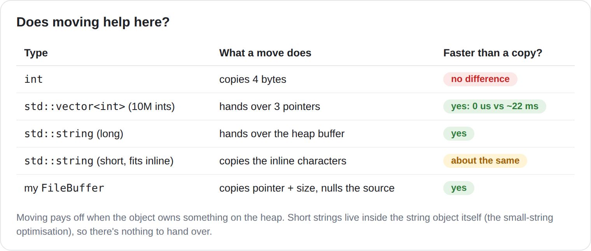

There's one more condition, and it's the reason for `noexcept`. When a `std::vector` runs out of capacity, it allocates a bigger block and relocates the existing elements. If a move constructor threw halfway through that, some elements would already have been moved out of the old block, and the vector couldn't go back to how it was. So the vector only moves elements whose move constructor is `noexcept`, and copies the others. `noexcept_vector.cpp` pushes 17 elements of two otherwise identical types:

```text
Safe: 0 copies, 31 moves during growth, 17 push_back moves
Risky: 31 copies, 0 moves during growth, 17 push_back moves
```

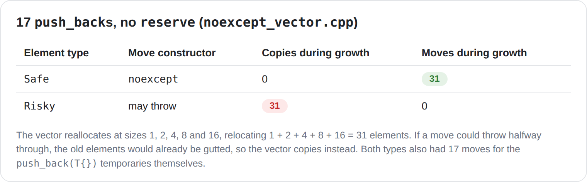

`Risky` only lacks `noexcept`, and every relocation copied it. For a `FileBuffer` that copy would be a full deep copy each time the vector grows.

Writing all five functions correctly took most of this module. [Module 10](../10-rule-of-zero-three-five/) is about designing classes so I don't have to write any of them.
