# Module 10: Resource design: Rule of Zero, Three and Five

In [Module 8](../08-copy-semantics/) and [Module 9](../09-move-semantics/) I wrote all five special member functions for one buffer class, and most of the effort went into keeping them consistent. This module turns that around: how do I design classes so that I don't write any of them? And for the few resources that do need a hand-written owner, what should that owner look like?

All the code is in [`examples/`](examples/). `./run.sh` builds every example, shows two compiler errors, and runs the Rule of Zero buffer under AddressSanitizer. The output is from GCC 11 on x86-64 Linux.

| File | What it shows | Run it |
|---|---|---|
| [`rule_of_zero.cpp`](examples/rule_of_zero.cpp) | A `StorageBuffer` built on `std::vector<char>`: copy, move and bounds checks with no special members written | [Compiler Explorer](https://godbolt.org/z/rTfrbT7KK) |
| [`special_members.cpp`](examples/special_members.cpp) | What the compiler generates for four small classes, and an empty destructor that turns moves into copies | [Compiler Explorer](https://godbolt.org/z/j8rjb1ee1) |
| [`file_handle.cpp`](examples/file_handle.cpp) | A non-copyable, movable owner for a Linux file descriptor | [Compiler Explorer](https://godbolt.org/z/a6ETx5KEK) |

---

## 10.1 The problem with managing the resource by hand

This is the class from Module 8 again:

```cpp
class FileBuffer {
    int* data;
    int size;

public:
    explicit FileBuffer(int s) : data(new int[s]), size(s) {}

    ~FileBuffer() {
        delete[] data;
    }
};
```

The destructor is correct, but every other way of using the class is broken:

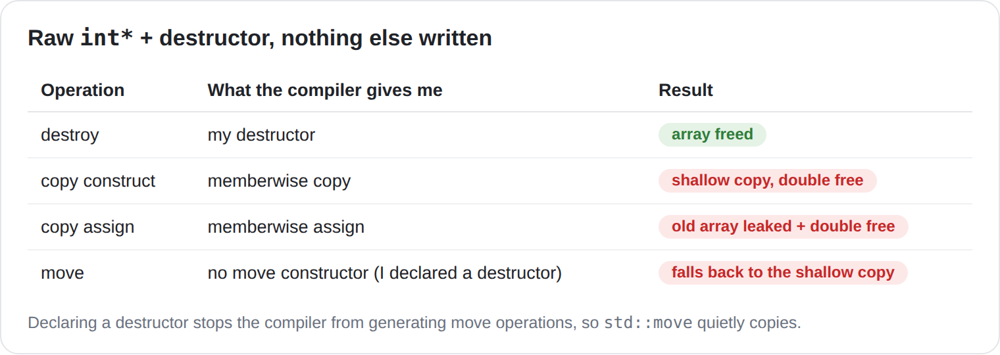

The last row is easy to miss. Because I declared a destructor, the compiler doesn't generate a move constructor at all. `FileBuffer b = std::move(a);` still compiles: it picks the copy constructor, which here is the shallow one. Section 10.5 shows this with real output.

## 10.2 Rule of Zero

The **Rule of Zero** says: design classes so they don't need a custom destructor, copy constructor, copy assignment, move constructor or move assignment. The way to do that is to make every member a type that already manages its own resource.

For the buffer, that's one changed line:

```cpp
class FileBuffer {
    std::vector<int> data;

public:
    explicit FileBuffer(int size) : data(size) {}
};
```


`std::vector` already allocates, frees, deep-copies and moves its storage. The compiler-generated special members of `FileBuffer` call the vector's, so they're all correct, and I wrote none of them.

## 10.3 What `std::vector` does for me

`std::vector<int> data(1000);` creates 1,000 zero-initialised ints. The vector object itself is small: on this platform it's three pointers, to the start of the elements, the end of the elements and the end of the allocated capacity. The elements live on the heap.

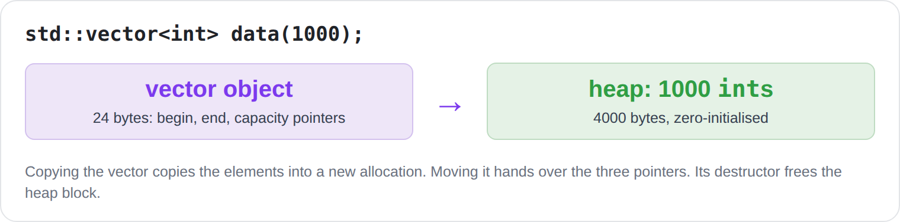

When the vector is destroyed, it frees that heap block, so `delete[]` never appears in my code.

## 10.4 Rule of Zero vs Three vs Five

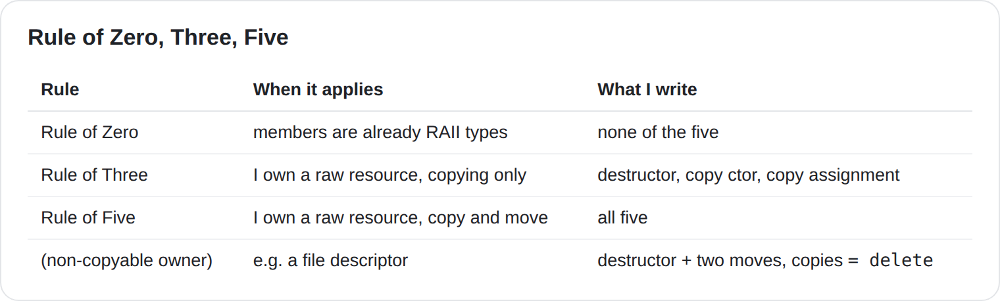

In practice I use them in this order:

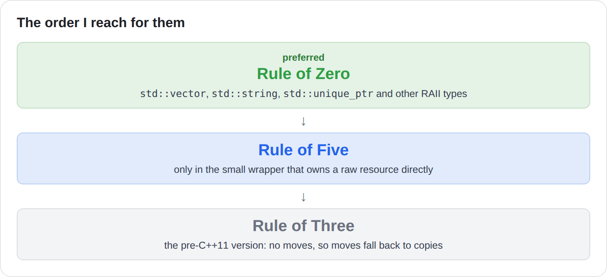

The Rule of Three is the same idea from before C++11, when there were no move operations. A class that follows it today still works, but every "move" of it is a copy.

## 10.5 What the compiler actually generated

I wanted to see this rather than take it on trust, so `special_members.cpp` asks the compiler with `<type_traits>` about four classes:

```cpp
struct RawOwner   { int* data = nullptr; ~RawOwner() { delete[] data; } };
struct ZeroVector { std::vector<int> data; };
struct ZeroUnique { std::unique_ptr<int[]> data; };
struct DtorOnly   { std::vector<int> data; ~DtorOnly() {} };
```

```text
type: copy-constructible / move-constructible / nothrow-move-constructible
RawOwner: yes / yes / yes
ZeroVector: yes / yes / yes
ZeroUnique: no / yes / yes
DtorOnly: yes / yes / no
```

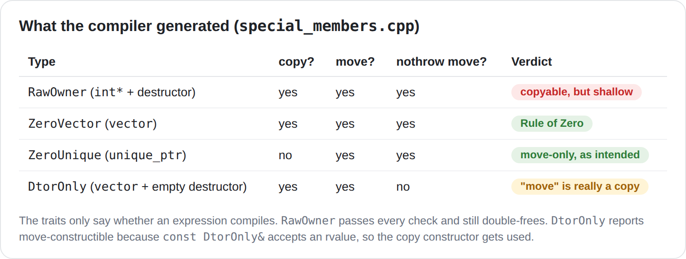

Two of these rows mislead. `RawOwner` passes every check and is still the double-free class from Module 8, because the traits only tell me whether a copy compiles, not whether it's correct. And `DtorOnly` says "move-constructible: yes", even though it has no move constructor. It reports yes because a `const DtorOnly&` copy constructor also accepts an rvalue. The program then moves both:

```text
ZeroVector: moved (same buffer: yes, a.data.size() = 0)
DtorOnly: copied (same buffer: no, a.data.size() = 1000)
```

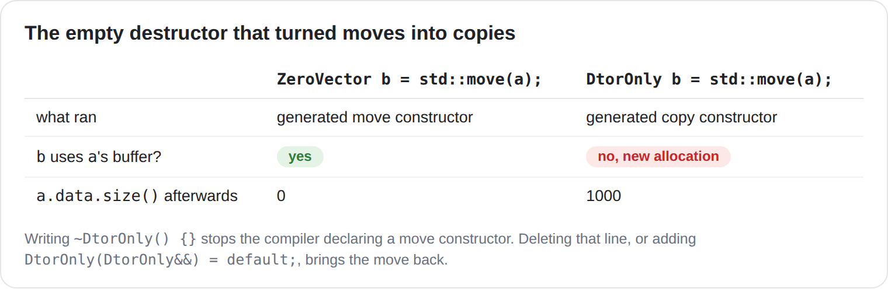

Writing `~DtorOnly() {}`, a destructor that does nothing, was enough to make every move of the class a full copy of its vector. The fix is to delete that line. If the destructor really is needed, I can add `DtorOnly(DtorOnly&&) = default;` and the other defaulted members back explicitly.

## 10.6 A production-style storage buffer

Here's a buffer I'd actually use in the storage server. It has no special members at all:

```cpp
class StorageBuffer {
    std::vector<char> data;

public:
    explicit StorageBuffer(std::size_t size) : data(size) {}

    void write(std::size_t index, char value) {
        data.at(index) = value;
    }

    char read(std::size_t index) const {
        return data.at(index);
    }

    std::size_t size() const {
        return data.size();
    }
};
```

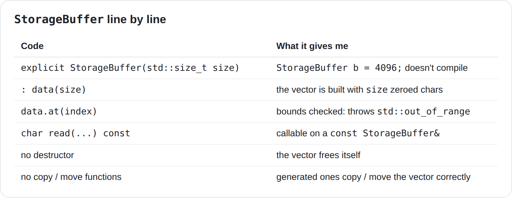

`rule_of_zero.cpp` copies it, writes to the copy, moves the copy, and reads past the end:

```cpp
StorageBuffer first(1'000'000);
first.write(0, 'A');
StorageBuffer second = first;
second.write(0, 'B');
StorageBuffer third = std::move(second);
first.read(1'000'000);
```

```text
first  buffer at 0x75c4b850b010
second buffer at 0x75c4b810b010
independent copy: yes
first.read(0) = A
second.read(0) = B
third took second's buffer: yes
out_of_range: vector::_M_range_check: __n (which is 1000000) >= this->size() (which is 1000000)
```

So `second = first` gave `second` its own independent million chars, because the generated copy constructor copied the vector, and the vector deep-copies. The move handed the buffer over without copying, and the out-of-range read threw instead of reading past the allocation. AddressSanitizer reports no errors.

`explicit` stops an `int` from silently turning into a buffer:

```text
rule_of_zero.cpp:53:30: error: conversion from ‘int’ to non-scalar type ‘StorageBuffer’ requested
```

## 10.7 `unique_ptr` or `vector`?

Both own memory, but for different shapes of data:

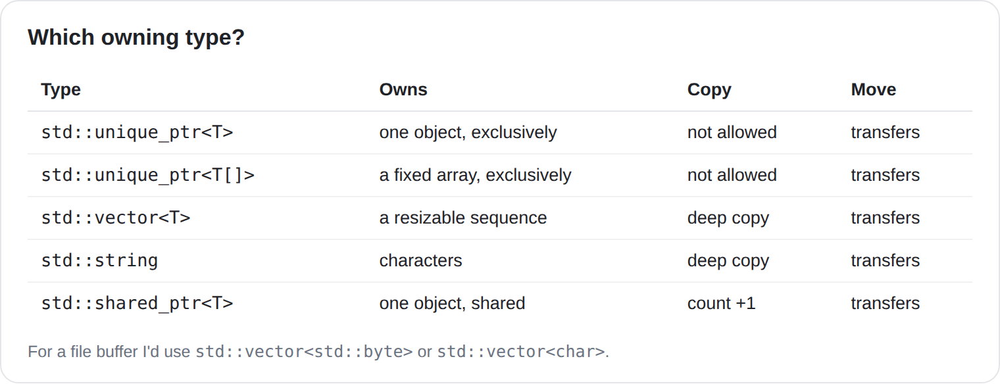

For a byte buffer that may change size, `std::vector<char>` or `std::vector<std::byte>` is usually the easier choice. For one object with a single owner, `std::unique_ptr` from [Module 6](../06-unique-ptr/).

## 10.8 Memory ownership vs resource ownership

Memory isn't the only resource a storage server owns. File descriptors, sockets and locks all have to be released exactly once, and some have no standard owner type:

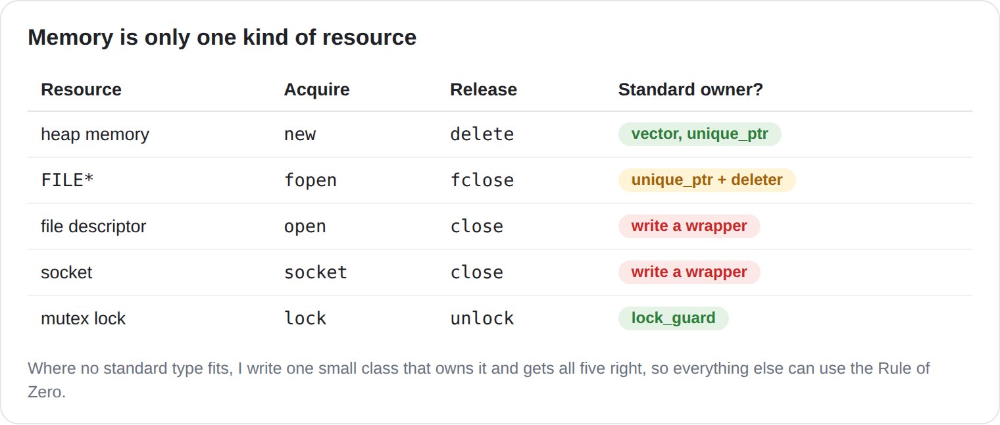

For those, I write one small class whose only job is to own the resource. That class is where the Rule of Five comes back. A file descriptor can't be meaningfully copied (two objects would close the same descriptor), so copying is deleted and moving transfers it:

```cpp
class FileHandle {
    int fd;

public:
    explicit FileHandle(const char* path) : fd(open(path, O_RDONLY)) {
        if (fd == -1) {
            throw std::system_error(errno, std::generic_category(), path);
        }
    }

    FileHandle(const FileHandle&) = delete;
    FileHandle& operator=(const FileHandle&) = delete;

    FileHandle(FileHandle&& other) noexcept : fd(std::exchange(other.fd, -1)) {}

    FileHandle& operator=(FileHandle&& other) noexcept {
        if (this != &other) {
            if (fd >= 0) {
                close(fd);
            }
            fd = std::exchange(other.fd, -1);
        }
        return *this;
    }

    ~FileHandle() {
        if (fd >= 0) {
            close(fd);
        }
    }
};
```

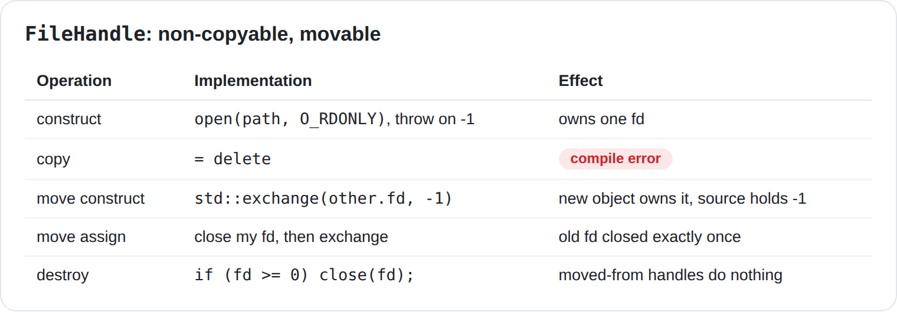

`file_handle.cpp` (which also prints each `open` and `close`) opens `/dev/null` twice, moves the handles around, and tries a path that doesn't exist:

```text
open -> fd 3
first.get() = -1
second.get() = 3
open -> fd 4
close(fd 3)
third.get() = -1
second.get() after move assignment = 4
/no/such/file: No such file or directory
close(fd 4)
```

Two descriptors were opened and each was closed exactly once. fd 3 was closed by the move assignment, when `second` took over fd 4. The moved-from handles held -1, so their destructors did nothing. Copying is a compile error:

```text
file_handle.cpp:65:23: error: use of deleted function ‘FileHandle::FileHandle(const FileHandle&)’
```

With `FileHandle` written once, any class that holds one, such as a `StorageFile` with a `FileHandle` and a `StorageBuffer`, follows the Rule of Zero again.

## Phase 2 in one picture

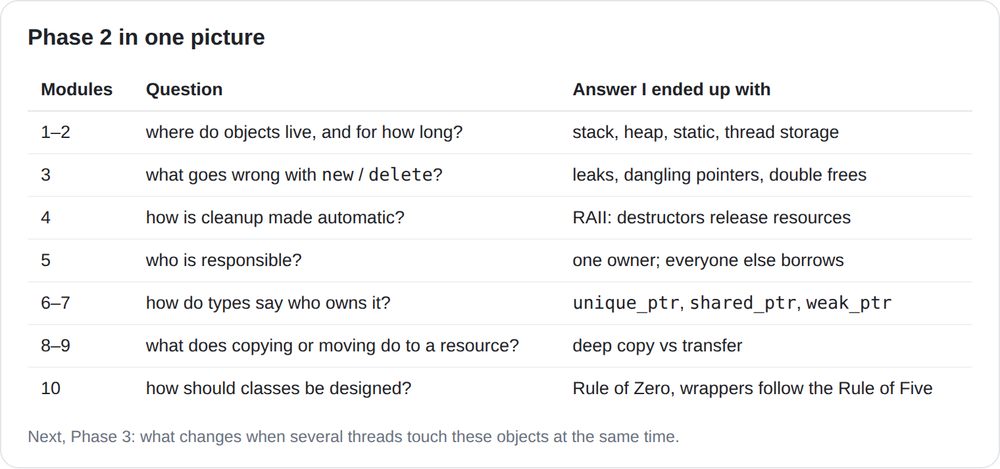

Everything in this phase assumed one thread. In Phase 3 I'll look at what changes when several threads use these objects at the same time, starting with the gap from Module 7: a `shared_ptr` keeps the object alive, but it doesn't stop two threads from writing to it at once.
